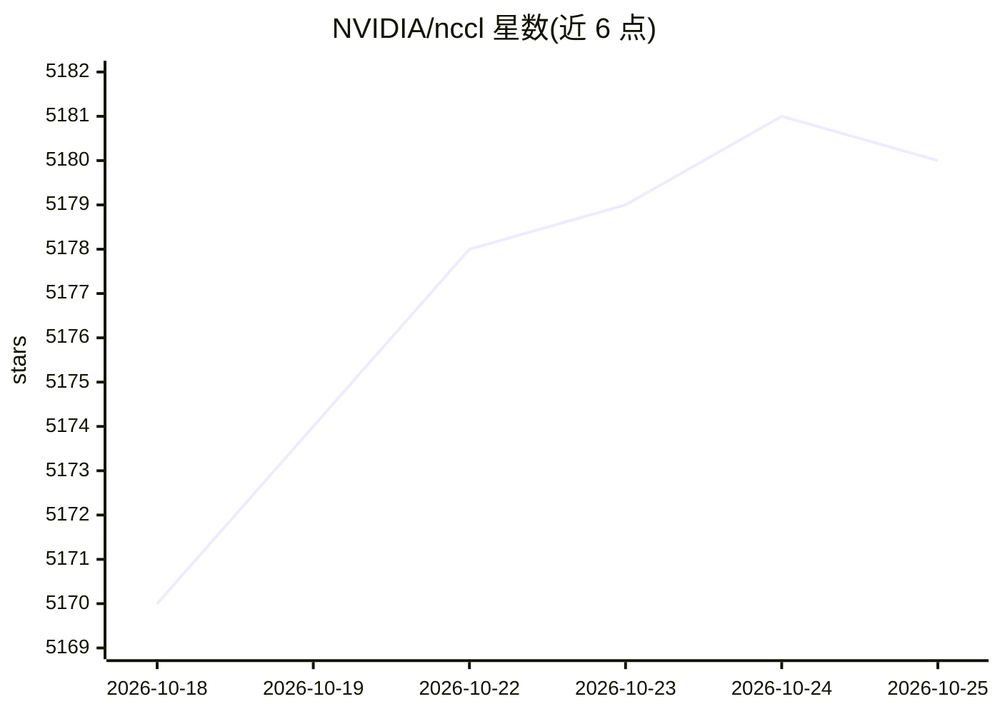

# NVIDIA/nccl

⭐ 5,185 · C++ · NOASSERTION · 推送 2026-10-23 · [GitHub](https://github.com/NVIDIA/nccl) · [官网](https://docs.nvidia.com/deeplearning/nccl/user-guide/docs/index.html) · 组织维护

**GPU 集合通信库：为多 GPU/多机提供高性能通信原语**

NVIDIA 维护的独立 GPU 通信例程库，实现 all-reduce、all-gather、broadcast、reduce-scatter 等 collective 操作及任意 send/receive 通信模式，针对 PCIe、NVLink、NVswitch 及 InfiniBand Verbs/TCP/IP 网络优化带宽。支持单机或多机的任意数量 GPU，可用于单进程或多进程（如 MPI）应用。从源码编译构建（依赖 CUDA，需指定 CUDA_HOME 若非默认路径），可打包为 deb/rpm/tarball/Python wheel 安装，官方测试版可从 NVIDIA 开发者站点下载。

## 筛选速览

| 维度 | 判定 | 备注 |
|---|---|---|
| AI 角色 | `ai-ecosystem` | LLM/agent 周边工具 |
| 许可风险 | `none` | NOASSERTION |
| 部署形态 | `None` |  |
| 模型依赖 | — | README 未给出锁定关系 |
| 硬件要求 | — | 无带数字的原话,不猜 |
| 安装摩擦 | `high` | 编译与系统依赖俱全 |
| 成熟度 | — | 结构信号不足 |

## 能力要点

- 实现 all-reduce/all-gather/broadcast/reduce-scatter 等全部集合通信原语
- 针对 PCIe/NVLink/NVswitch/InfiniBand/TCP IP 优化
- 支持单机或多机任意数量 GPU，兼容单/多进程（MPI）应用
- 可构建 deb/rpm/tarball/Python wheel 多种安装包

## 适用场景

- 多 GPU 训练框架底层的跨卡梯度同步通信
- 多机集群中节点间集合通信
- 深度学习推理或 HPC 应用的 GPU 数据交换

## 场景标签

`模型训练` · 领域:训练与推理

## 证据(README 行号)

> L7: NCCL (pronounced "Nickel") is a stand-alone library of standard communication routines for GPUs, implementing all-re
> L13: Note: the official and tested builds of NCCL can be downloaded from: https://developer.nvidia.com/nccl. You can ski

## 星数曲线

2026-10-18 5,170 → 2026-10-25 5,180（+10）

---
*卡片 v1 · prompt 1.4 · 生成 2026-10-20 · 置信度 high · 依据 README sha `02e6f8ec748b` · [字段定义](../../DATASET.md)*
