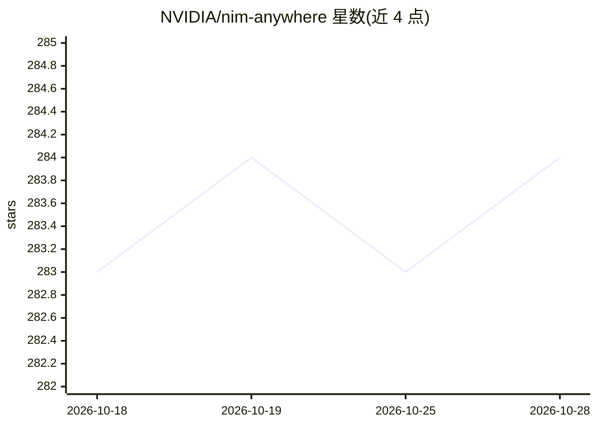

# NVIDIA/nim-anywhere

⭐ 284 · Python · Apache-2.0 · 推送 2026-09-03 · [GitHub](https://github.com/NVIDIA/nim-anywhere) · [官网](https://www.nvidia.com/en-us/ai/) · 组织维护

**基于 NVIDIA NIM 微服务构建 RAG 应用的项目模板**

NVIDIA 官方维护的 Gen AI 项目模板（Clone Me），配合 NVIDIA AI Workbench 使用，提供接入 LLM NIM、Embedding NIM、Reranker NIM 构建检索增强生成（RAG）应用的工具链，并可从实验室环境扩展到生产。快速开始流程包括：生成 NGC Personal Key、Docker 认证 nvcr.io、安装 AI Workbench（Windows/macOS/Ubuntu 客户端，远程机仅限 Ubuntu）、克隆或 Fork 本仓库。脱离 AI Workbench 运行需手动配置，预置自动化与集成可能不可用。

## 筛选速览

| 维度 | 判定 | 备注 |
|---|---|---|
| AI 角色 | `ai-ecosystem` | LLM/agent 周边工具 |
| 许可风险 | `permissive` | Apache-2.0 |
| 部署形态 | `desktop` | 安装包/桌面程序 |
| 模型依赖 | — | README 未给出锁定关系 |
| 硬件要求 | — | 无带数字的原话,不猜 |
| 安装摩擦 | `low` | 无编译、无系统依赖或容器化 |
| 成熟度 | — | 结构信号不足 |

## 能力要点

- 覆盖 LLM/Embedding/Reranker 三类 NIM 微服务的 RAG 集成工具链
- 原生支持从实验室到生产环境的扩展
- 与 NVIDIA AI Workbench 集成的本地/远程开发机工作流
- 支持 Python 3.10-3.12，含 CI 流水线

## 适用场景

- 企业用内部数据构建 RAG 问答应用
- 在 NVIDIA AI Workbench 中快速起步 NIM 集成开发
- 远程实验室机器上集中部署 Gen AI 开发环境

## 场景标签

`RAG` · 领域:知识与检索

## 证据(README 行号)

> L22: NIM Anywhere contains all the tooling required to start integrating NIMs
> L23: for RAG. It natively scales out to full-sized labs and up to production
> L101: This project is designed to be used with [NVIDIA AI

## 星数曲线

2026-10-18 283 → 2026-10-28 284（+1）

---
*卡片 v1 · prompt 1.4 · 生成 2026-10-22 · 置信度 mid · 依据 README sha `00a24e664264` · [字段定义](../../DATASET.md)*
