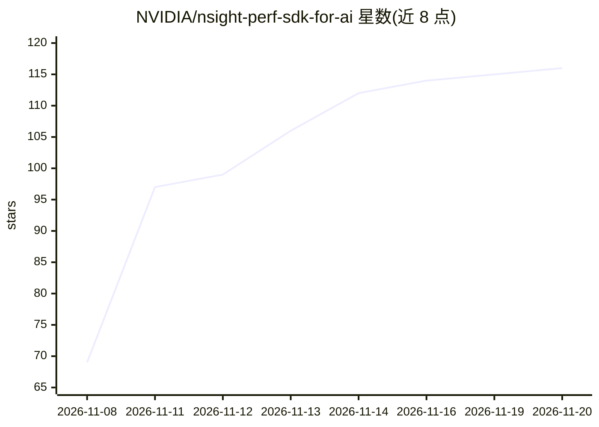

# NVIDIA/nsight-perf-sdk-for-ai

⭐ 116 · CMake · Apache-2.0 · 推送 2026-11-17 · [GitHub](https://github.com/NVIDIA/nsight-perf-sdk-for-ai) · [官网](https://developer.nvidia.com/nsight-perf-sdk) · 组织维护

**面向 AI 负载的 GPU/CUDA 常驻低开销性能追踪 SDK**

NVIDIA 提供的 C++ 客户端 API 与命令行工具 SDK，用于持续采集 NVIDIA GPU 与 CUDA API 的性能数据：CUDA 调用、GPU 工作负载、PM 计数器、功耗、上下文切换与 NVTX 标记等。架构为独立服务进程采集并发布 provider 缓冲区，客户端读取后写出 Trace Stream Database，可导出 Perfetto 格式查看。要求 Blackwell/Rubin 架构 GPU、CUDA Toolkit 13.5+ 与指定驱动版本，需源码编译（CMake 3.24+、C++17），服务可执行文件为专有二进制另行下载。当前为 Beta Preview，README 列出多项已知限制（如 NVTX start-end 范围不支持、fork 场景问题）。

## 筛选速览

| 维度 | 判定 | 备注 |
|---|---|---|
| AI 角色 | `ai-ecosystem` | LLM/agent 周边工具 |
| 许可风险 | `permissive` | Apache-2.0 |
| 部署形态 | `desktop` | 安装包/桌面程序 |
| 模型依赖 | — | README 未给出锁定关系 |
| 硬件要求 | — | 无带数字的原话,不猜 |
| 安装摩擦 | `high` | 编译与系统依赖俱全 |
| 成熟度 | `idea` | |

## 能力要点

- 常驻后台的持续 profiling，README 报告 GPU 受限负载下观测开销 <1%
- 采集 CUDA API 调用、GPU 工作负载、PM 计数器、功耗、上下文切换、NVTX 等数据源
- 服务/客户端两层架构，客户端可连接服务读取 provider 缓冲区
- Trace Stream Database 可导出 Perfetto 格式并在 ui.perfetto.dev 查看

## 适用场景

- AI 训练/推理负载运行期间持续采集 GPU 与 CUDA 性能数据
- 在 Slurm 多进程或集群环境中做 GPU profiling
- 将采集的 trace 导出 Perfetto 做离线性能分析

## 场景标签

`MLOps` · 领域:训练与推理

## 证据(README 行号)

> L5: The NVIDIA Nsight Perf SDK provides APIs and tools for continuously collecting and consuming performance data from N
> L39: - GPU: NVIDIA Blackwell and Rubin architectures
> L143: 1. The **service** runs in a separate process, collects data from GPU and target-side providers, and publishes pro

## 星数曲线

2026-11-08 69 → 2026-11-20 116（+47）

---
*卡片 v1 · prompt 1.4 · 生成 2026-11-17 · 置信度 high · 依据 README sha `b55ed03fc579` · [字段定义](../../DATASET.md)*
