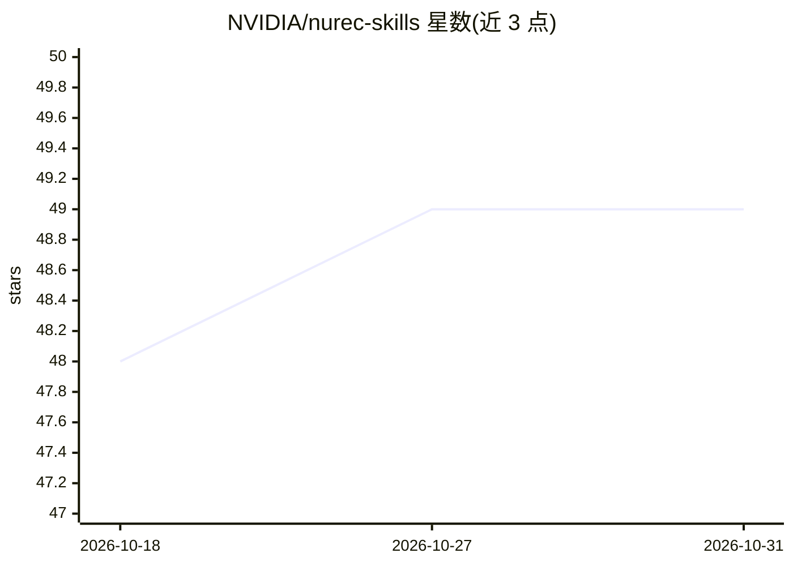

# NVIDIA/nurec-skills

⭐ 49 · Python · Apache-2.0 · 推送 2026-09-02 · [GitHub](https://github.com/NVIDIA/nurec-skills) · 组织维护

**教 AI agent 驱动 NVIDIA 神经重建流水线的技能文件仓库**

NVIDIA 维护的 agent 技能（skills）仓库：6 个 SKILL.md 格式的薄协调层技能，教支持 agentskills.io 规范的 agent（Cursor、Claude Code、Codex 等）如何驱动 NuRec 神经重建全流程——传感器数据转 NCore 格式、3DGUT/3DGRT 高斯重建与渲染、3D 资产提取、渲染后处理，以及 PhysicalAI 数据集目录。技能不重新分发 NVIDIA 源码，只指向 NGC 容器、GitHub 仓库和 HuggingFace 工件，上游版本记录在 frontmatter 中。运行被驱动的工作流需要 Linux x86_64、CUDA 12.x、Ampere 及以上 GPU 与 Docker。

## 筛选速览

| 维度 | 判定 | 备注 |
|---|---|---|
| AI 角色 | `ai-knowledge` | 知识聚合/清单类 |
| 许可风险 | `permissive` | Apache-2.0 |
| 部署形态 | `library` | 以包/库形式分发 |
| 模型依赖 | — | README 未给出锁定关系 |
| 硬件要求 | — | 无带数字的原话,不猜 |
| 安装摩擦 | `medium` | 含编译或系统依赖之一 |
| 成熟度 | — | 结构信号不足 |

## 能力要点

- 6 个技能覆盖 NuRec 重建渲染全流程，含 nurec-index 路由技能
- 遵循 agentskills.io 规范，可被 Cursor / Claude Code / Codex 按名称解析
- 技能不重分发源码，仅驱动 NGC 容器、GitHub 仓库与 HuggingFace 工件
- 上游版本（NRE 容器 tag 等）记录在 SKILL.md frontmatter 便于随版本更新

## 适用场景

- 让代码 agent 按自然语言指令完成 NuRec 神经重建与渲染任务
- 把 ROS 2 bag 等传感器记录转换为 NCore V4 格式
- 从自动驾驶片段提取 3D 高斯溅射资产并做渲染后处理
- 查找 NVIDIA PhysicalAI 系列数据集

## 场景标签

`提示工程` · 领域:Agent 开发

## 证据(README 行号)

> L11: A **skill** is a single Markdown file (plus a few companion files)
> L20: These skills are **thin coordination layers**. They don't redistribute
> L21: NVIDIA source; instead, they teach an agent how to drive the public

## 星数曲线

2026-10-18 48 → 2026-10-31 49（+1）

---
*卡片 v1 · prompt 1.4 · 生成 2026-10-25 · 置信度 mid · 依据 README sha `0ca6df5094aa` · [字段定义](../../DATASET.md)*
