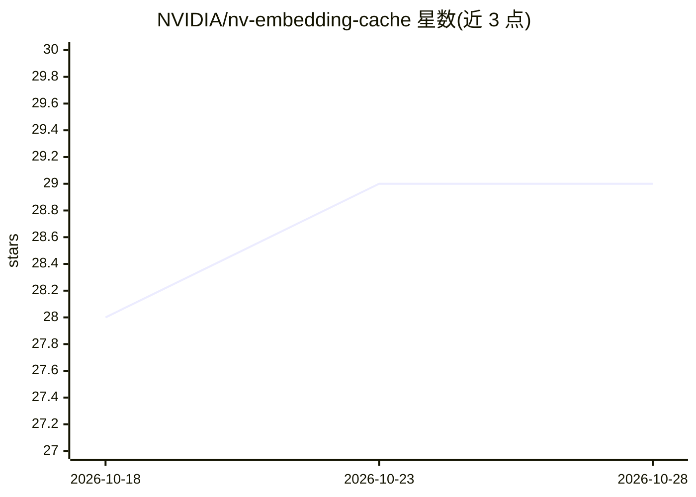

# NVIDIA/nv-embedding-cache

⭐ 29 · C++ · Apache-2.0 · 推送 2026-10-20 · [GitHub](https://github.com/NVIDIA/nv-embedding-cache) · 组织维护

**面向推荐系统的分层嵌入查表 SDK，支持超 GPU 显存的嵌入推理**

NVIDIA 维护的领域专用 SDK，用 GPU/Host 内存中的软件缓存与定制 CUDA 核加速推荐系统的嵌入查表，主要面向嵌入规模超出本地 GPU 显存容量的推荐推理场景。提供四种配置：全 GPU 线性内存（GPULayer）、GPU 缓存+线性内存（LinearUVM）、GPU/Host 分层缓存+远程参数服务器（Hierarchical）、纯 CPU Host 查表（HostLayer），提供 Python 与 C++ 两套接口。安装需 C++17 编译器、CUDA 12.8+、CMake 3.18+、Python 3.10+ 与 Torch，从源码构建，可用 Dockerfile 满足前置条件；Redis 为可选测试依赖。

## 筛选速览

| 维度 | 判定 | 备注 |
|---|---|---|
| AI 角色 | `ai-ecosystem` | LLM/agent 周边工具 |
| 许可风险 | `permissive` | Apache-2.0 |
| 部署形态 | `self-host` | docker 或自建部署 |
| 模型依赖 | — | README 未给出锁定关系 |
| 硬件要求 | — | 无带数字的原话,不猜 |
| 安装摩擦 | `low` | 无编译、无系统依赖或容器化 |
| 成熟度 | — | 结构信号不足 |

## 能力要点

- GPU/Host 分层缓存加速嵌入查表，面向超显容量的推荐推理
- 四种内存配置：GPULayer / LinearUVM / Hierarchical / HostLayer
- Python（NVEmbedding）与 C++ 双接口，pip 安装 Python 绑定
- 提供文档、示例与基准测试脚本

## 适用场景

- 推荐模型推理时嵌入表超出单卡显存的查表加速
- 构建带远程参数服务器的分层嵌入缓存
- 对比不同 GPU/Host 内存配置下的查表性能

## 场景标签

`推荐系统` `推理引擎` · 领域:学习与行业

## 证据(README 行号)

> L7: NV Embedding Cache is a domain-specific SDK for high performance recommender systems embedding lookup.
> L8: We accelerate embedding lookups with a combination of SW caches in GPU/Host memory and customized CUDA kernels.

## 星数曲线

2026-10-18 28 → 2026-10-28 29（+1）

---
*卡片 v1 · prompt 1.4 · 生成 2026-10-26 · 置信度 high · 依据 README sha `d8beb3b343cb` · [字段定义](../../DATASET.md)*
