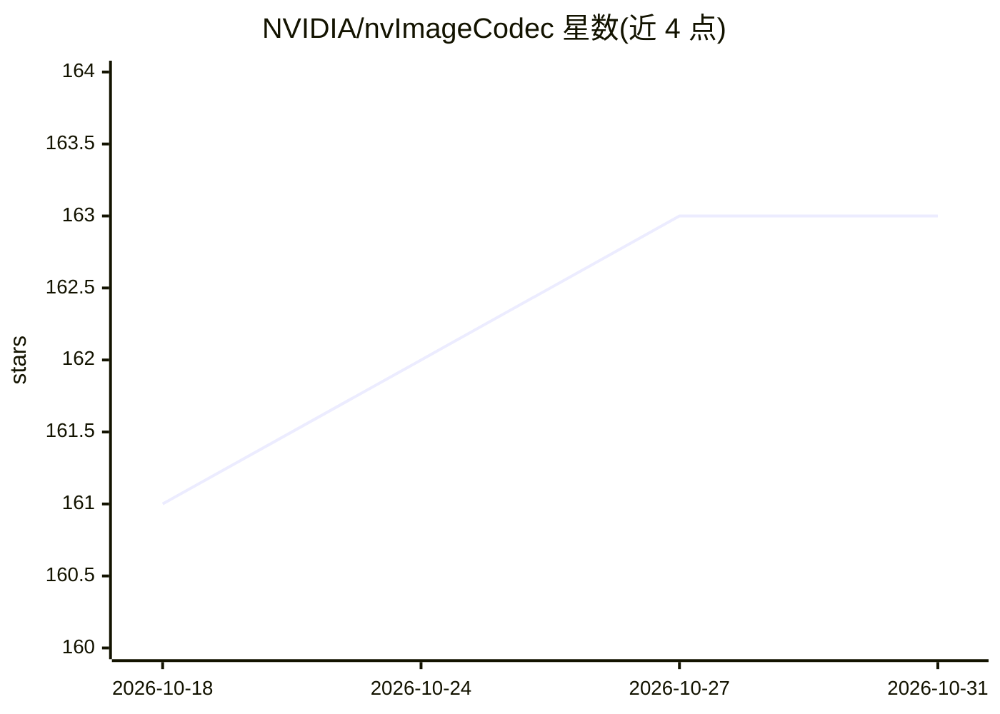

# NVIDIA/nvImageCodec

⭐ 163 · Jupyter Notebook · Apache-2.0 · 推送 2026-07-14 · [GitHub](https://github.com/NVIDIA/nvImageCodec) · [官网](https://docs.nvidia.com/cuda/nvimagecodec/index.html) · 组织维护

**GPU/CPU 加速图像编解码库：统一接口解码编码多格式图像**

NVIDIA 维护的开源图像编解码库，以扩展插件框架形式提供 GPU 加速的 JPEG/JPEG2000/TIFF 编解码（含 Jetson 硬件解码器），并以 libjpeg-turbo/libtiff/OpenCV 扩展作为 CPU 回退；内置格式检测解析器，支持批处理、变长形状、编解码器优先级与自动回退，提供 Python 绑定及到 CV-CUDA/PyTorch/CuPy 的零拷贝接口，面向深度学习图像数据管线场景。需 CUDA Toolkit 12.1+ 与 NVIDIA 驱动，通过 PyPI wheel 或源码构建安装。

## 筛选速览

| 维度 | 判定 | 备注 |
|---|---|---|
| AI 角色 | `ai-ecosystem` | LLM/agent 周边工具 |
| 许可风险 | `permissive` | Apache-2.0 |
| 部署形态 | `self-host` | docker 或自建部署 |
| 模型依赖 | — | README 未给出锁定关系 |
| 硬件要求 | — | 无带数字的原话,不猜 |
| 安装摩擦 | `low` | 无编译、无系统依赖或容器化 |
| 成熟度 | — | 结构信号不足 |

## 能力要点

- 统一 API 支持 JPEG/JPEG2000/TIFF/BMP/PNG/PNM/WebP 格式检测
- GPU 加速扩展（nvjpeg/nvjpeg2k/nvtiff）+ 第三方 CPU 扩展自动回退
- 批处理支持变长形状与异构格式图像
- 到 CV-CUDA、PyTorch、CuPy 的零拷贝接口

## 适用场景

- 深度学习训练前的大批量图像解码预处理
- GPU 上做图像转码（nvimtrans 示例应用）
- 在 PyTorch/CuPy 管线中零拷贝读取解码结果

## 场景标签

`图像视频处理` · 领域:感知与多模态

## 证据(README 行号)

> L15: The nvImageCodec is an open-source library of accelerated codecs with unified interface.
> L25: - Zero-copy interfaces to CV-CUDA, PyTorch and CuPy

## 星数曲线

2026-10-18 161 → 2026-10-31 163（+2）

---
*卡片 v1 · prompt 1.4 · 生成 2026-10-22 · 置信度 low · 依据 README sha `bb10b43bad92` · [字段定义](../../DATASET.md)*
