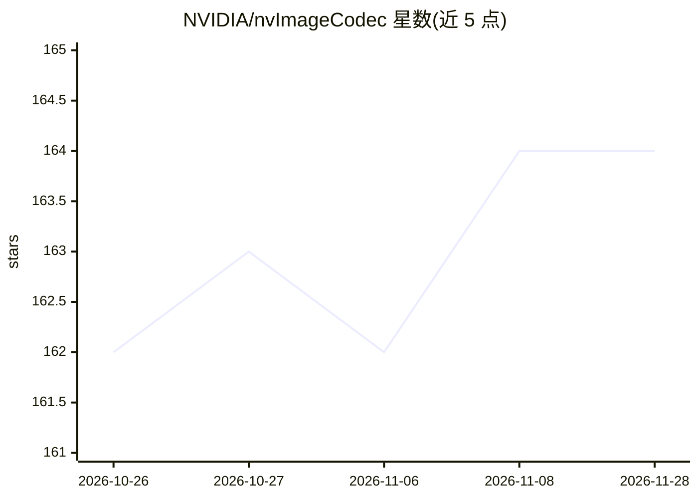

# NVIDIA/nvImageCodec

⭐ 164 · Jupyter Notebook · Apache-2.0 · 推送 2026-11-19 · [GitHub](https://github.com/NVIDIA/nvImageCodec) · [官网](https://docs.nvidia.com/cuda/nvimagecodec/index.html) · 组织维护

**NVIDIA 的 GPU/CPU 加速图像编解码库，统一接口**

nvImageCodec 是一个提供统一接口的加速图像编解码库，采用扩展模块框架形式交付编解码插件。内置 jpeg、jpeg2000、tiff、bmp、png、pnm、webp 格式解析器，原生扩展包括 nvjpeg（硬件/CUDA 编解码）、nvjpeg2k、nvtiff，另有 libturbo-jpeg、libtiff、opencv 等第三方 CPU 扩展作为回退。支持批处理异构格式图像、编解码器优先级自动回退，并提供到 CV-CUDA、PyTorch、CuPy 的零拷贝接口与 Python 绑定。依赖 CUDA Toolkit >= 12.1 与相应 NVIDIA 驱动。

## 筛选速览

| 维度 | 判定 | 备注 |
|---|---|---|
| AI 角色 | `ai-ecosystem` | LLM/agent 周边工具 |
| 许可风险 | `permissive` | Apache-2.0 |
| 部署形态 | `self-host` | docker 或自建部署 |
| 模型依赖 | — | README 未给出锁定关系 |
| 硬件要求 | — | 无带数字的原话,不猜 |
| 安装摩擦 | `low` | 无编译、无系统依赖或容器化 |
| 成熟度 | — | 结构信号不足 |

## 能力要点

- 统一 API 的 GPU/CPU 图像解码与编码，支持批处理异构格式
- 编解码器优先级与自动回退机制
- 到 CV-CUDA、PyTorch、CuPy 的零拷贝接口与 Python 绑定
- 扩展模块框架，可插拔 nvjpeg/nvjpeg2k/nvtiff 等插件

## 适用场景

- 深度学习训练流水线中 GPU 加速图像解码
- 图像转码批处理任务
- 医学/遥感等 JPEG2000 TIFF 场景的 CUDA 加速读写

## 场景标签

`图像视频处理` · 领域:感知与多模态

## 证据(README 行号)

> L15: The nvImageCodec is an open-source library of accelerated codecs with unified interface.
> L25: - Zero-copy interfaces to CV-CUDA, PyTorch and CuPy

## 星数曲线

2026-10-26 162 → 2026-11-28 164（+2）

---
*卡片 v1 · prompt 1.4 · 生成 2026-11-27 · 置信度 mid · 依据 README sha `7ea2945c6c49` · [字段定义](../../DATASET.md)*
