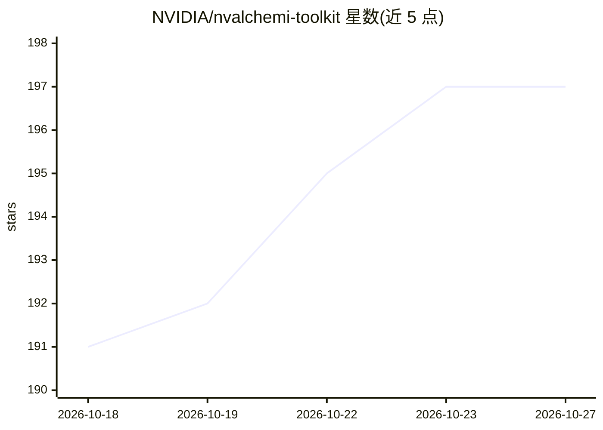

# NVIDIA/nvalchemi-toolkit

⭐ 197 · Python · Apache-2.0 · 推送 2026-10-23 · [GitHub](https://github.com/NVIDIA/nvalchemi-toolkit) · [官网](https://nvidia.github.io/nvalchemi-toolkit/) · 组织维护

**化学与材料科学 AI 原子模拟的 GPU 加速 Python 框架**

NVIDIA 开发的 GPU-first Python 框架，面向化学与材料科学的机器学习原子间势（MLIP）工作流：批量运行分子动力学与结构弛豫（inflight batching），支持自带 MACE、AIMNet2、UMA 模型或通过 BaseModelMixin 封装其他 MLIP，可组合能量/力/应力目标进行训练与微调，并通过空间域分解实现多 GPU 扩展。基于 PyTorch 与 warp-lang 的 GPU 优化算子库 nvalchemi-toolkit-ops。当前处于公开 beta，API 可能变更。

## 筛选速览

| 维度 | 判定 | 备注 |
|---|---|---|
| AI 角色 | `ai-native` | 本体是模型或模型工具 |
| 许可风险 | `permissive` | Apache-2.0 |
| 部署形态 | `library` | 以包/库形式分发 |
| 模型依赖 | — | README 未给出锁定关系 |
| 硬件要求 | — | 无带数字的原话,不猜 |
| 安装摩擦 | `medium` | 含编译或系统依赖之一 |
| 成熟度 | `idea` | |

## 能力要点

- 单次模型前向批量运行多个 MD/弛豫任务（inflight batching）
- 支持 MACE/AIMNet2/UMA 或通过 BaseModelMixin 封装自定义 MLIP
- 能量/力/应力多目标训练与分布式数据并行
- 空间域分解将大型原子体系拆分到多 GPU

## 适用场景

- 在 GPU 上批量运行动力学与几何优化任务
- 训练或微调机器学习原子间势模型
- 将大型原子体系模拟扩展到多 GPU 系统

## 场景标签

`微调` `模型训练` · 领域:训练与推理

## 证据(README 行号)

> L10: NVIDIA ALCHEMI Toolkit is a GPU-first Python framework for AI atomic simulations.
> L11: Run batched molecular dynamics (MD) and relaxation, train or fine-tune
> L19: - **Bring your own model**: use MACE, AIMNet2 or UMA, or wrap another MLIP with

## 星数曲线

2026-10-18 191 → 2026-10-27 197（+6）

---
*卡片 v1 · prompt 1.4 · 生成 2026-10-22 · 置信度 high · 依据 README sha `63592733d8a1` · [字段定义](../../DATASET.md)*
