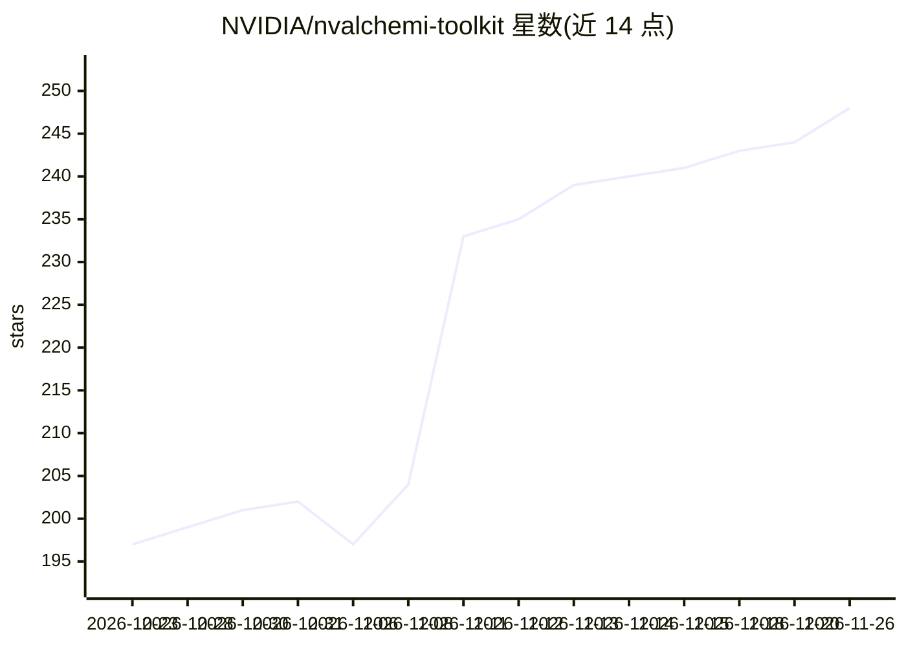

# NVIDIA/nvalchemi-toolkit

⭐ 248 · Python · Apache-2.0 · 推送 2026-11-23 · [GitHub](https://github.com/NVIDIA/nvalchemi-toolkit) · [官网](https://nvidia.github.io/nvalchemi-toolkit/) · 组织维护

**面向化学/材料研究者的 GPU 原子模拟训练推理框架**

NVIDIA 出品的 GPU-first Python 框架，用于 AI 原子模拟：支持批量分子动力学（MD）与几何弛豫、机器学习原子间势（MLIP）的训练/微调/蒸馏，可使用 MACE、AIMNet2、UMA 等模型或通过 BaseModelMixin 封装自有模型；提供生成式结构生成、晶体结构预测原语、NEB 能量景观探索与空间域分解多 GPU 扩展。基于 nvalchemi-toolkit-ops 的 GPU 优化邻居列表与交互核，目前处于公开 beta 阶段，API 可能变更。

## 筛选速览

| 维度 | 判定 | 备注 |
|---|---|---|
| AI 角色 | `ai-native` | 本体是模型或模型工具 |
| 许可风险 | `permissive` | Apache-2.0 |
| 部署形态 | `library` | 以包/库形式分发 |
| 模型依赖 | — | README 未给出锁定关系 |
| 硬件要求 | — | 无带数字的原话,不猜 |
| 安装摩擦 | `medium` | 含编译或系统依赖之一 |
| 成熟度 | `idea` | |

## 能力要点

- 批量 GPU 模拟：一次模型前向运行多个 MD/弛豫任务，inflight batching 保持 GPU 占用
- 支持 MACE/AIMNet2/UMA 及自定义 MLIP 封装，计算能量、力、应力与 Hessian
- 训练/微调/LoRA 适配与蒸馏，含分布式数据并行与可重启 checkpoint
- Agent-ready：提供 agent skill 与 AGENTS.md 指导编码代理使用 API

## 适用场景

- 在 NVIDIA GPU 上批量运行动力学模拟与几何优化
- 训练或微调机器学习原子间势（MLIP）模型
- 生成候选材料结构并进行晶体结构预测与去重
- 让编码代理自动编写 nvalchemi 代码

## 场景标签

`微调` `推理引擎` · 领域:训练与推理

## 证据(README 行号)

> L10: NVIDIA ALCHEMI Toolkit is a GPU-first Python framework for AI atomic simulations.
> L11: Run batched molecular dynamics (MD) and relaxation, train or fine-tune
> L23: - **Training, fine-tuning and distillation**: combine energy, force and stress objectives

## 星数曲线

2026-10-23 197 → 2026-11-26 248（+51）

---
*卡片 v1 · prompt 1.4 · 生成 2026-11-26 · 置信度 high · 依据 README sha `2b698ea3041a` · [字段定义](../../DATASET.md)*
