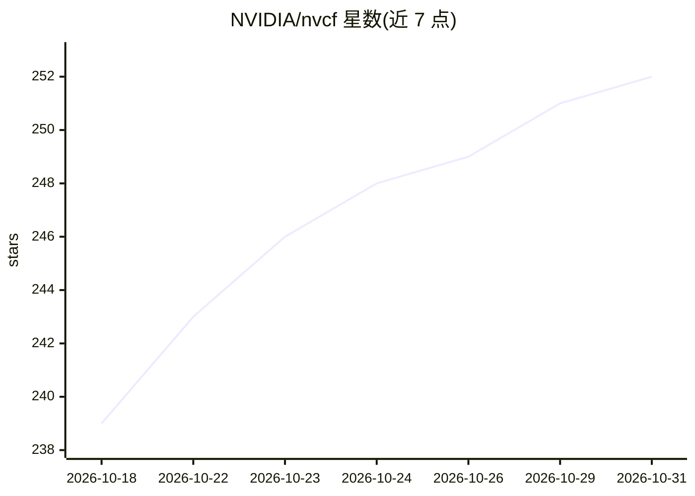

# NVIDIA/nvcf

⭐ 252 · Go · Apache-2.0 · 推送 2026-10-30 · [GitHub](https://github.com/NVIDIA/nvcf) · [官网](https://docs.nvidia.com/nvcf/overview) · 组织维护

**部署与路由 GPU 加速推理/流式/批处理工作负载的云函数平台**

NVIDIA Cloud Functions（NVCF）是自管理的 GPU 工作负载平台：控制面管理函数与部署状态，调用面处理 HTTP/流式/gRPC 请求的路由与限流，GPU 集群经 NVIDIA Cluster Agent（NVCA）接入。函数为长驻可调用工作负载（容器或 Helm chart 打包），任务为异步运行至完成的批处理/微调/评测作业；支持多集群自动扩缩、混合 GPU 类型与遥测。Monorepo 含服务代码、CLI、部署资产与文档，用 Bazel 构建，Apache-2.0 许可。

## 筛选速览

| 维度 | 判定 | 备注 |
|---|---|---|
| AI 角色 | `ai-ecosystem` | LLM/agent 周边工具 |
| 许可风险 | `permissive` | Apache-2.0 |
| 部署形态 | `library` | 以包/库形式分发 |
| 模型依赖 | — | README 未给出锁定关系 |
| 硬件要求 | — | 无带数字的原话,不猜 |
| 安装摩擦 | `low` | 无编译、无系统依赖或容器化 |
| 成熟度 | — | 结构信号不足 |

## 能力要点

- 函数（长驻推理/流式）与任务（批处理/微调）两类工作负载
- 控制面/调用面/计算面分离，NVIDIA Cluster Agent 接入 GPU 集群
- 多区域多集群负载均衡路由与从零到最大副本的自动扩缩
- 提供 nvcf-cli 命令行工具与 Helm chart 部署资产

## 适用场景

- 在自有 Kubernetes 集群上自建 GPU 推理服务平台
- 运行批量推理、评测与微调等 run-to-completion 任务
- 跨区域多 GPU 集群统一调度推理与流式工作负载

## 场景标签

`推理引擎` · 领域:训练与推理

## 证据(README 行号)

> L17: NVIDIA Cloud Functions (NVCF) is a platform for deploying, managing, and running GPU-accelerated workloads at scale
> L49: NVCF functions are long-running, invokable workloads. Use a function when a

## 星数曲线

2026-10-18 239 → 2026-10-31 252（+13）

---
*卡片 v1 · prompt 1.4 · 生成 2026-10-22 · 置信度 high · 依据 README sha `bab390512149` · [字段定义](../../DATASET.md)*
