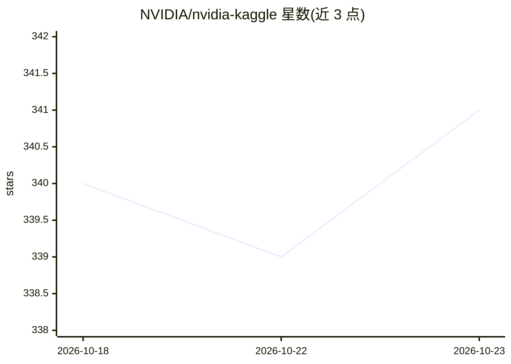

# NVIDIA/nvidia-kaggle

⭐ 341 · Python · MIT · 推送 2026-08-04 · [GitHub](https://github.com/NVIDIA/nvidia-kaggle) · 组织维护

**给 agent 的 Kaggle 竞赛全流程技能插件（单一 skill）**

NVIDIA 维护的 agent 技能插件，通过单一 skill `nvidia-kaggle-skill` 让 Codex、Claude Code 等兼容 Agent Skills 的运行时完成 Kaggle 竞赛端到端工作流：抓取竞赛概览与规则、检索并总结榜单 writeup、索引讨论区与公开 kernel、下载 notebook 与数据到本地工作区复现、提交 kernel 并轮询结果、上传管理数据集。技能接受竞赛 slug、URL、kernel ref 或本地路径等自然输入，自动选择对应脚本。需要 Python 3.10+、Kaggle 账号与 KAGGLE_API_TOKEN。经 plugin marketplace 或复制技能目录安装。

## 筛选速览

| 维度 | 判定 | 备注 |
|---|---|---|
| AI 角色 | `ai-ecosystem` | LLM/agent 周边工具 |
| 许可风险 | `permissive` | MIT |
| 部署形态 | `None` |  |
| 模型依赖 | — | README 未给出锁定关系 |
| 硬件要求 | — | 无带数字的原话,不猜 |
| 安装摩擦 | `low` | 无编译、无系统依赖或容器化 |
| 成熟度 | — | 结构信号不足 |

## 能力要点

- 单一 skill 覆盖竞赛调研、kernel 复现、提交与数据集管理全流程
- 支持 Codex 与 Claude Code 的 plugin marketplace 安装，也可复制到任意 Agent Skills 运行时
- 输入兼容竞赛 slug / Kaggle URL / kernel ref / writeup URL / 本地路径
- 附带 BENCHMARK.md 的技能评测摘要与 pytest 测试套件

## 适用场景

- 开新竞赛时让 agent 汇总历史优胜方案与公开 kernel
- 把榜单 notebook 连同数据下载到本地工作区跑通
- 通过对话让 agent 提交竞赛 kernel 并跟踪结果

## 场景标签

`工作流自动化` `数据分析` · 领域:效率与自动化

## 证据(README 行号)

> L9: NVIDIA Kaggle Plugin gives agents end-to-end Kaggle competition workflows through a single skill, `nvidia-kaggle-ski
> L30: - An agent runtime with plugin or Agent Skills support, such as Codex, Claude Code, or another compatible harness.

## 星数曲线

2026-10-18 340 → 2026-10-23 341（+1）

---
*卡片 v1 · prompt 1.4 · 生成 2026-10-21 · 置信度 high · 依据 README sha `7e9dec359356` · [字段定义](../../DATASET.md)*
