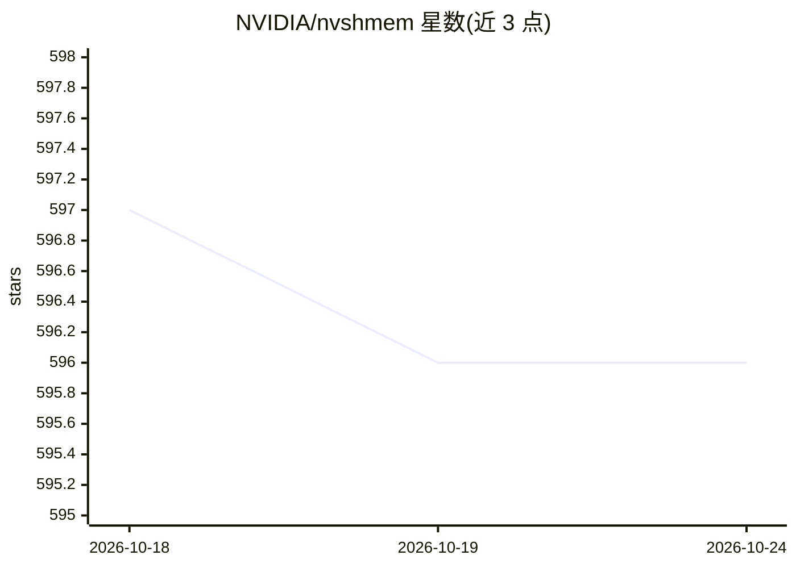

# NVIDIA/nvshmem

⭐ 595 · C++ · Apache-2.0 · 推送 2026-10-19 · [GitHub](https://github.com/NVIDIA/nvshmem) · [官网](https://docs.nvidia.com/nvshmem/api/index.html) · 组织维护

**面向 NVIDIA GPU 集群的一侧通信并行编程库（OpenSHMEM 风格）**

NVSHMEM 是基于 OpenSHMEM 的并行编程接口，在多块 NVIDIA GPU 之间提供分区全局地址空间：应用通过对称内存执行单侧传输、原子操作、信号、同步与集合通信，并支持宿主、CUDA kernel 与 CUDA stream 三类接口，使 CPU 或 GPU 线程均可发起通信，用于降低多进程通信与协调开销。面向 GPU 集群上的 HPC 与深度学习开发者，以 C/C++ 库（含 CMake 导入目标）与 Python 接口（NVSHMEM4Py）形式提供。要求 Linux 系统、NVIDIA 驱动、CUDA Toolkit、至少两块数据中心 GPU 及进程启动器（Open MPI/Hydra/Slurm）。Apache 2.0 许可。

## 筛选速览

| 维度 | 判定 | 备注 |
|---|---|---|
| AI 角色 | `ai-ecosystem` | LLM/agent 周边工具 |
| 许可风险 | `permissive` | Apache-2.0 |
| 部署形态 | `None` |  |
| 模型依赖 | — | README 未给出锁定关系 |
| 硬件要求 | — | 无带数字的原话,不猜 |
| 安装摩擦 | `high` | 编译与系统依赖俱全 |
| 成熟度 | — | 结构信号不足 |

## 能力要点

- 跨 GPU 分区全局地址空间与对称内存
- 宿主/CUDA kernel/CUDA stream 三类通信接口
- 提供 CMake 导入目标与 NVSHMEM4Py Python 接口
- 支持 Open MPI、Hydra、Slurm 等进程启动器

## 适用场景

- GPU 集群上多进程应用的单侧通信与集合通信
- 深度学习/HPC 训练任务降低多进程通信开销
- 在 CUDA kernel 内直接发起通信的并行程序开发

## 场景标签

 · 领域:高性能计算/GPU 通信库

## 证据(README 行号)

> L3: GPU-initiated communication for scalable NVIDIA GPU clusters.
> L9: atomics, signaling, synchronization, and collective operations. NVSHMEM provides host, CUDA kernel,
> L22: - Two NVIDIA data center GPUs.

## 星数曲线

2026-10-18 597 → 2026-10-24 596（-1）

---
*卡片 v1 · prompt 1.4 · 生成 2026-10-21 · 置信度 mid · 依据 README sha `3ef04d92aa89` · [字段定义](../../DATASET.md)*
