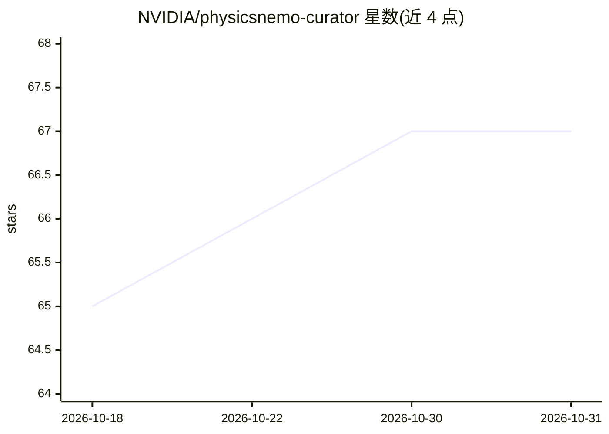

# NVIDIA/physicsnemo-curator

⭐ 67 · Python · Apache-2.0 · 推送 2026-10-20 · [GitHub](https://github.com/NVIDIA/physicsnemo-curator) · [官网](https://nvidia.github.io/physicsnemo-curator/) · 组织维护

**构建科学工程领域 AI 就绪数据集的加速 ETL 工具包**

NVIDIA 维护的 Python ETL 工具包，用于在 CAE、气象/气候、分子动力学等科学工程领域构建 AI 就绪数据集。核心机制为流式管道 API（Source → Filter → Sink 链式表达）、惰性生成器语义，支持非结构网格、gridded 数据数组与原子/分子数据三类域，可插拔执行后端（线程池、进程池、Dask、Prefect 等），并带全局注册表、psnc CLI 交互式管道向导与 dashboard。要求 Python>=3.11、Linux x86_64，源码构建需 Rust 工具链；包处于 beta，无 API 稳定性保证。

## 筛选速览

| 维度 | 判定 | 备注 |
|---|---|---|
| AI 角色 | `ai-ecosystem` | LLM/agent 周边工具 |
| 许可风险 | `permissive` | Apache-2.0 |
| 部署形态 | `library` | 以包/库形式分发 |
| 模型依赖 | — | README 未给出锁定关系 |
| 硬件要求 | — | 无带数字的原话,不猜 |
| 安装摩擦 | `low` | 无编译、无系统依赖或容器化 |
| 成熟度 | `idea` | |

## 能力要点

- 流式 Source → Filter → Sink 管道 API，惰性生成器语义
- 支持网格/数据数组/原子分子三类科学数据域与域专属扩展包
- 可插拔执行后端：sequential、线程/进程池、Loky、Dask、Prefect
- psnc 交互式 CLI 管道向导与 pipeline dashboard

## 适用场景

- 为物理 ML 模型训练准备 CAE/气象/分子动力学数据集
- 编写自定义数据源、过滤器与汇构建处理管道
- 用交互式向导组装并监控数据流水线

## 场景标签

`MLOps` · 领域:训练与推理

## 证据(README 行号)

> L15: **PhysicsNeMo Curator** is an accelerated ETL toolkit for building
> L16: AI-ready datasets across multiple scientific and engineering domains,
> L17: including CAE, weather/climate, molecular dynamics, and more. Curator is

## 星数曲线

2026-10-18 65 → 2026-10-31 67（+2）

---
*卡片 v1 · prompt 1.4 · 生成 2026-10-24 · 置信度 high · 依据 README sha `4cda2fee1d03` · [字段定义](../../DATASET.md)*
