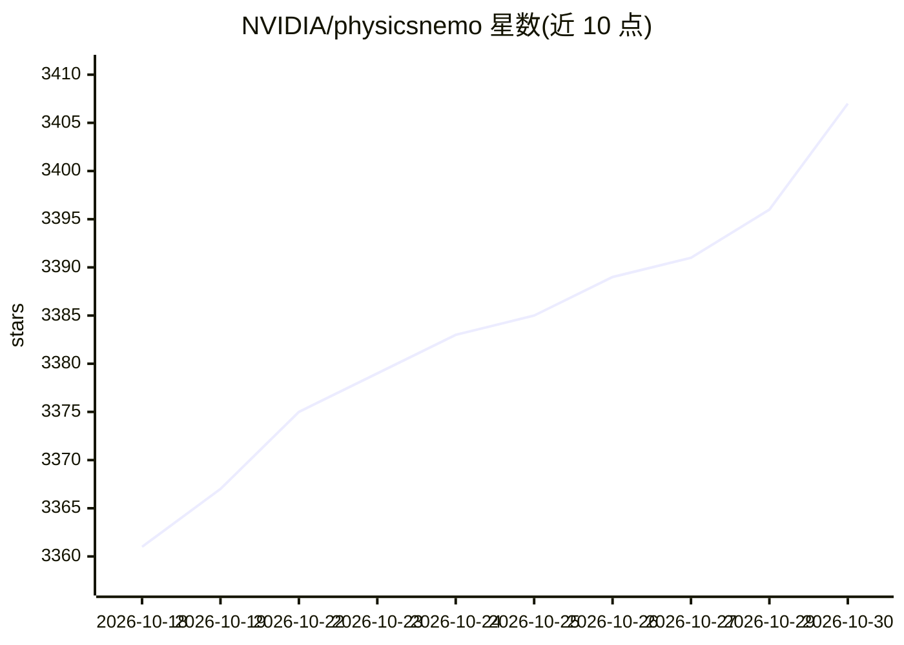

# NVIDIA/physicsnemo

⭐ 3,407 · Python · Apache-2.0 · 推送 2026-10-29 · [GitHub](https://github.com/NVIDIA/physicsnemo) · [官网](https://developer.nvidia.com/physicsnemo) · 组织维护

**面向物理机器学习的 PyTorch 框架：构建、训练科学计算模型**

NVIDIA 开源的 PyTorch 物理机器学习框架，提供可复用库组件与端到端训练 recipe，覆盖 CFD、天气预报、结构力学、地球物理、医疗、增材制造等领域。模型族包括 FNO/DPOT、MeshGraphNet、Transolver/GeoTransolver、AFNO/GraphCast、扩散模型等，均为普通 torch.nn.Module，可与现有 PyTorch 工作流组合。提供 ShardTensor 域并行将单个高分辨率样本跨 GPU 切分，配合 DDP/FSDP2。通过 pip 安装，支持 CUDA 13/12 后端；experimental 模块 API 可能变更。

## 筛选速览

| 维度 | 判定 | 备注 |
|---|---|---|
| AI 角色 | `ai-ecosystem` | LLM/agent 周边工具 |
| 许可风险 | `permissive` | Apache-2.0 |
| 部署形态 | `library` | 以包/库形式分发 |
| 模型依赖 | — | README 未给出锁定关系 |
| 硬件要求 | — | 无带数字的原话,不猜 |
| 安装摩擦 | `medium` | 含编译或系统依赖之一 |
| 成熟度 | `idea` | |

## 能力要点

- 按物理领域组织端到端训练 recipe（空气动力学、天气、结构、地球物理等）
- ShardTensor 域并行将单个样本跨 GPU 切分，配合 DDP/FSDP2
- 模型为普通 torch.nn.Module，可复用架构/层/算子/数据变换而不替换现有 PyTorch 工作流
- 支持 ONNX 导出、LoRA 微调、主动学习循环与扩散工具包

## 适用场景

- 训练外流空气动力学或数据中心气流替代模型
- 构建全球/区域 AI 天气预报模型
- 做生成式拓扑优化或扩散式全波形反演
- 在结构碰撞、金属烧结等仿真场景构建瞬态代理模型

## 场景标签

`模型训练` · 领域:训练与推理

## 证据(README 行号)

> L19: NVIDIA PhysicsNeMo is an open-source PyTorch framework for physics machine learning
> L20: (physics ML), scientific machine learning (SciML), and AI for science and engineering.
> L109: PhysicsNeMo supplies reusable models, training components, and recipes. For a

## 星数曲线

2026-10-18 3,361 → 2026-10-30 3,407（+46）

---
*卡片 v1 · prompt 1.4 · 生成 2026-10-20 · 置信度 high · 依据 README sha `b346c7c199eb` · [字段定义](../../DATASET.md)*
