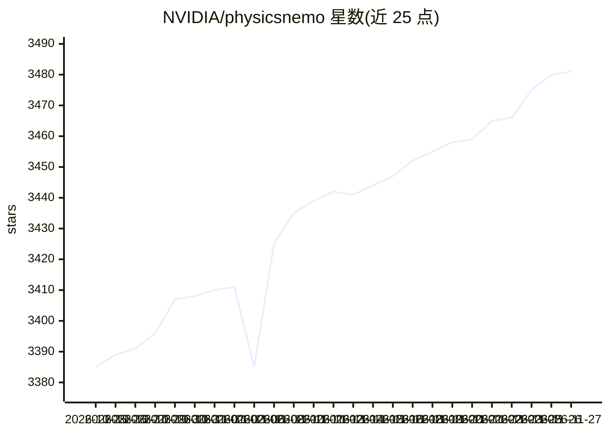

# NVIDIA/physicsnemo

⭐ 3,481 · Python · Apache-2.0 · 推送 2026-11-26 · [GitHub](https://github.com/NVIDIA/physicsnemo) · [官网](https://developer.nvidia.com/physicsnemo) · 组织维护

**科学/工程研究者的物理机器学习 PyTorch 框架**

NVIDIA 开源的 PyTorch 框架，用于构建、训练和微调基于物理的机器学习模型（Physics-ML、SciML、AI for science）。提供可复用组件（模型、数据管道、指标、ShardTensor 域并行）与端到端训练配方，覆盖空气动力学、天气、结构、地球物理、医疗等领域；模型为普通 torch.nn.Module，按数据表示（网格/点云/图）组织。通过 pip 安装，CUDA 12 后端仅限 Linux，experimental 模块 API 可能变动。

## 筛选速览

| 维度 | 判定 | 备注 |
|---|---|---|
| AI 角色 | `ai-native` | 本体是模型或模型工具 |
| 许可风险 | `permissive` | Apache-2.0 |
| 部署形态 | `library` | 以包/库形式分发 |
| 模型依赖 | — | README 未给出锁定关系 |
| 硬件要求 | — | 无带数字的原话,不猜 |
| 安装摩擦 | `medium` | 含编译或系统依赖之一 |
| 成熟度 | — | 结构信号不足 |

## 能力要点

- 提供 FNO、MeshGraphNet、Transolver、AFNO、GraphCast 等模型家族与训练配方
- ShardTensor 域并行可将单样本切分到多 GPU，兼容 DDP/FSDP2
- 内置 Mesh/DomainMesh 组件，支持 GPU 拓扑、重网格化与可微变形
- 提供供 Codex/Claude Code 等编码代理使用的两个官方技能

## 适用场景

- 训练外部空气动力学或碰撞仿真的代理模型
- 构建全球天气预报与气候预测模型
- 用扩散模型做随机区域预报或反问题求解
- 以主动学习循环迭代选择新仿真样本

## 场景标签

`模型训练` · 领域:训练与推理

## 证据(README 行号)

> L19: NVIDIA PhysicsNeMo is an open-source PyTorch framework for physics machine learning
> L21: It provides reusable library components and end-to-end training recipes.
> L121: PhysicsNeMo models are ordinary `torch.nn.Module` objects. Choose a family by the

## 星数曲线

2026-10-25 3,385 → 2026-11-27 3,481（+96）

---
*卡片 v1 · prompt 1.4 · 生成 2026-11-23 · 置信度 high · 依据 README sha `74816f7a6b38` · [字段定义](../../DATASET.md)*
