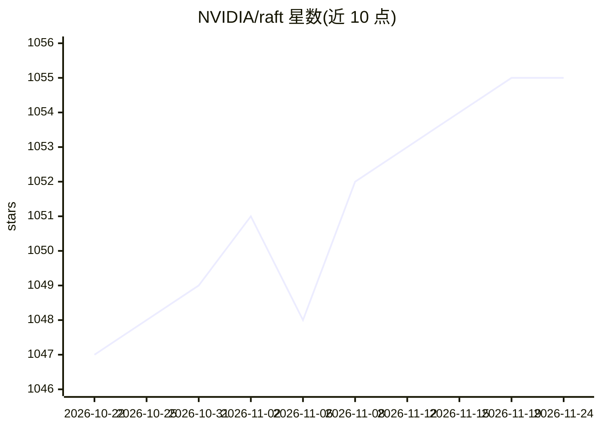

# NVIDIA/raft

⭐ 1,055 · Cuda · Apache-2.0 · 推送 2026-11-20 · [GitHub](https://github.com/NVIDIA/raft) · [官网](https://docs.nvidia.com/raft/) · 组织维护

**面向开发者与数据源提供方的 CUDA 加速机器学习基础算法原语库**

RAFT 是 NVIDIA 维护的 C++ header-only 模板库（含可选共享库），提供机器学习与数据挖掘领域的基础算法与原语，覆盖线性代数、稀疏运算、聚类、统计、求解器与最近邻搜索等类别。另提供 pylibraft 与 raft-dask 两个 Python 库，后者支持基于 Dask 的多机多 GPU 分布式部署；输出数组通过 __cuda_array_interface__ 与 CuPy、PyTorch、cuDF 等库互操作。README 明确说明其定位为底层原语库，不面向数据科学家的直接探索使用。

## 筛选速览

| 维度 | 判定 | 备注 |
|---|---|---|
| AI 角色 | `ai-native` | 本体是模型或模型工具 |
| 许可风险 | `permissive` | Apache-2.0 |
| 部署形态 | `library` | 以包/库形式分发 |
| 模型依赖 | — | README 未给出锁定关系 |
| 硬件要求 | — | 无带数字的原话,不猜 |
| 安装摩擦 | `medium` | 含编译或系统依赖之一 |
| 成熟度 | — | 结构信号不足 |

## 能力要点

- C++ header-only 模板库加可选共享库，提供免 CUDA 编译器的 host-accessible runtime API
- pylibraft 轻量 Python 封装，支持 __cuda_array_interface__ 与 CuPy/Numba/PyTorch/cuDF 互操作
- raft-dask 提供多机多 GPU 通信基础设施
- 可通过 conda 或 pip 安装，按 CUDA 12/13 版本提供包

## 适用场景

- 为 GPU 应用提供距离计算、线性代数等加速原语
- 在 Dask 集群上构建多机多 GPU 分布式算法
- 作为下游项目的可复用计算基础组件

## 场景标签

`向量数据库` · 领域:知识与检索

## 证据(README 行号)

> L17: RAFT contains fundamental widely-used algorithms and primitives for machine learning and data mining. The algorithm
> L35: RAFT is a C++ header-only template library with an optional shared library that
> L39: In addition being a C++ library, RAFT also provides 2 Python libraries:

## 星数曲线

2026-10-22 1,047 → 2026-11-24 1,055（+8）

---
*卡片 v1 · prompt 1.4 · 生成 2026-11-24 · 置信度 high · 依据 README sha `a5a2ecd6feec` · [字段定义](../../DATASET.md)*
