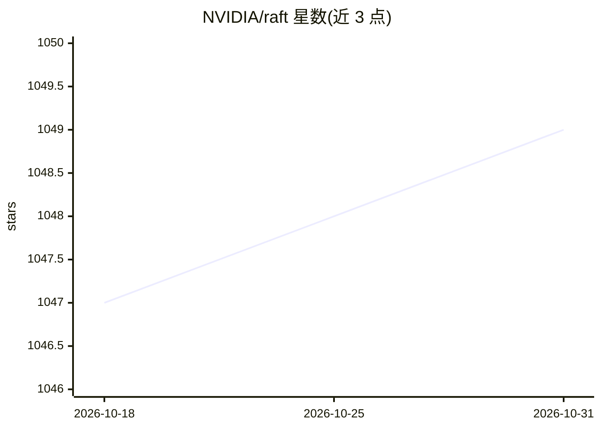

# NVIDIA/raft

⭐ 1,049 · Cuda · Apache-2.0 · 推送 2026-10-30 · [GitHub](https://github.com/NVIDIA/raft) · [官网](https://docs.nvidia.com/raft/) · 组织维护

**面向开发者的 CUDA 加速机器学习基础算法构件库**

RAFT 提供 CUDA 加速的机器学习与数据挖掘基础算法与原语，涵盖稀疏/稠密线性代数、求解器、统计、采样与多节点多 GPU 工具等类别，作为构建应用的构件块。形态为 C++ header-only 模板库（可选拼为共享库），另提供 pylibraft 轻量 Python 封装与 raft-dask 分布式通信库。面向数据源提供方与应用开发者，README 明确不供数据科学家直接做探索实验。

## 筛选速览

| 维度 | 判定 | 备注 |
|---|---|---|
| AI 角色 | `ai-ecosystem` | LLM/agent 周边工具 |
| 许可风险 | `permissive` | Apache-2.0 |
| 部署形态 | `library` | 以包/库形式分发 |
| 模型依赖 | — | README 未给出锁定关系 |
| 硬件要求 | — | 无带数字的原话,不猜 |
| 安装摩擦 | `medium` | 含编译或系统依赖之一 |
| 成熟度 | `idea` | |

## 能力要点

- C++ header-only 模板库，含可选共享库与 host 可访问 runtime API
- pylibraft 接受任何实现 __cuda_array_interface__ 的数组，支持输出为 CuPy/PyTorch/cuDF/Numpy
- raft-dask 提供多节点多 GPU 通信抽象层
- 通过 Conda/mamba 与 Pip 安装（pip 包为实验性）

## 适用场景

- 在我的 GPU 应用中复用线性代数、距离计算等加速原语
- 通过 pylibraft 在 Python 中调用 RAFT 算法并与 CuPy/PyTorch 互转数据
- 基于 Dask 搭建多节点多 GPU 分布式算法

## 场景标签

`向量数据库` · 领域:知识与检索

## 证据(README 行号)

> L17: RAFT contains fundamental widely-used algorithms and primitives for machine learning and data mining. The algorithm
> L47: RAFT contains low-level primitives for accelerating applications and workflows. Data source providers and applicati

## 星数曲线

2026-10-18 1,047 → 2026-10-31 1,049（+2）

---
*卡片 v1 · prompt 1.4 · 生成 2026-10-21 · 置信度 high · 依据 README sha `ab517eac1dd6` · [字段定义](../../DATASET.md)*
