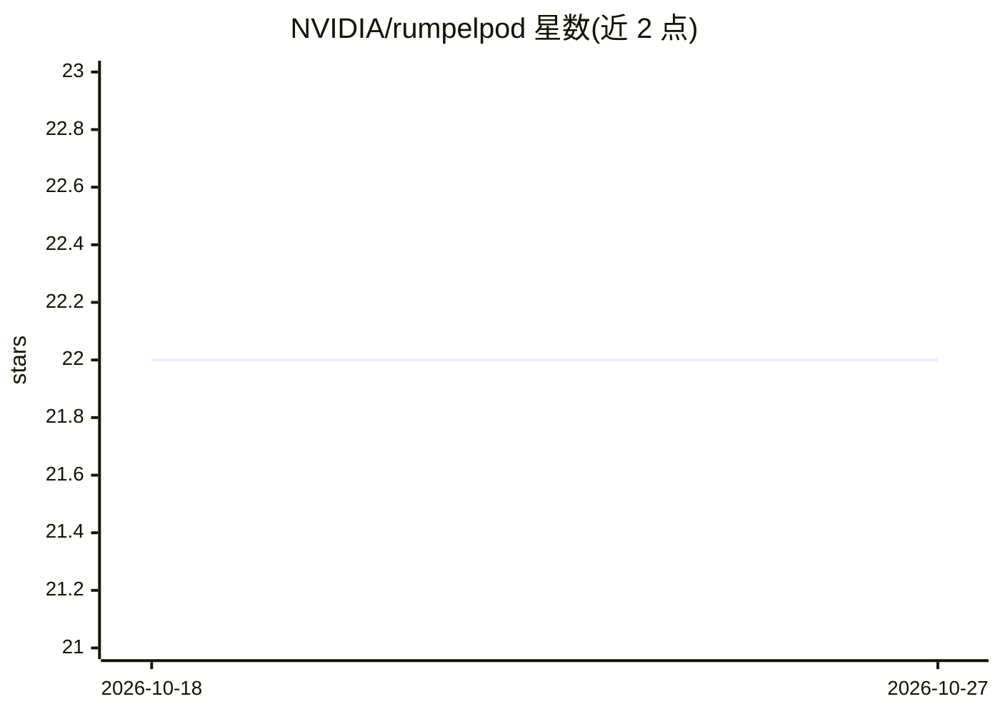

# NVIDIA/rumpelpod

⭐ 22 · Rust · Apache-2.0 · 推送 2026-10-26 · [GitHub](https://github.com/NVIDIA/rumpelpod) · 组织维护

**在容器中编排多个 LLM 编码 agent 并行工作的工具**

NVIDIA 维护的编排工具：在 Docker/Podman 容器或 Kubernetes pod 中管理同一仓库的多个独立命名工作区，每个 pod 有完整克隆并经 git 同步，多个 LLM 编码 agent 可并行工作互不干扰。支持本地或经 SSH 的远程 Docker 主机及 Kubernetes，负责 git 同步、端口转发与容器生命周期。Claude Code 与 OpenAI Codex 为一等 agent（rumpel claude / rumpel codex），容器镜像通过 devcontainer.json 定义，兼容 gVisor、Kata Containers。通过 install.sh 脚本安装，需 git 与 Docker 或 Podman。

## 筛选速览

| 维度 | 判定 | 备注 |
|---|---|---|
| AI 角色 | `ai-ecosystem` | LLM/agent 周边工具 |
| 许可风险 | `permissive` | Apache-2.0 |
| 部署形态 | `None` |  |
| 模型依赖 | — | README 未给出锁定关系 |
| 硬件要求 | — | 无带数字的原话,不猜 |
| 安装摩擦 | `low` | 无编译、无系统依赖或容器化 |
| 成熟度 | — | 结构信号不足 |

## 能力要点

- 多 pod 独立工作区，agent 并行工作互不干扰
- 支持本地/远程 Docker、Podman 与 Kubernetes 运行
- rumpel claude / rumpel codex 一等支持 Claude Code 与 Codex
- devcontainer.json 定义镜像，兼容 gVisor/Kata Containers 隔离运行时

## 适用场景

- 在同一仓库上并行运行多个 LLM 编码 agent 处理不同任务
- 审查各 agent 的改动（git diff/difftool）后用 rumpel merge 合并
- 在远程主机或 Kubernetes 集群上隔离运行编码 agent

## 场景标签

`编码 Agent` `多智能体` · 领域:Agent 开发

## 证据(README 行号)

> L3: Manage multiple independent workspaces of a repository in Docker or Podman containers, or Kubernetes pods, on local 
> L22: The main use case is running LLM coding agents.

## 星数曲线

2026-10-18 22 → 2026-10-27 22（+0）

---
*卡片 v1 · prompt 1.4 · 生成 2026-10-27 · 置信度 high · 依据 README sha `13a1127a34c0` · [字段定义](../../DATASET.md)*
