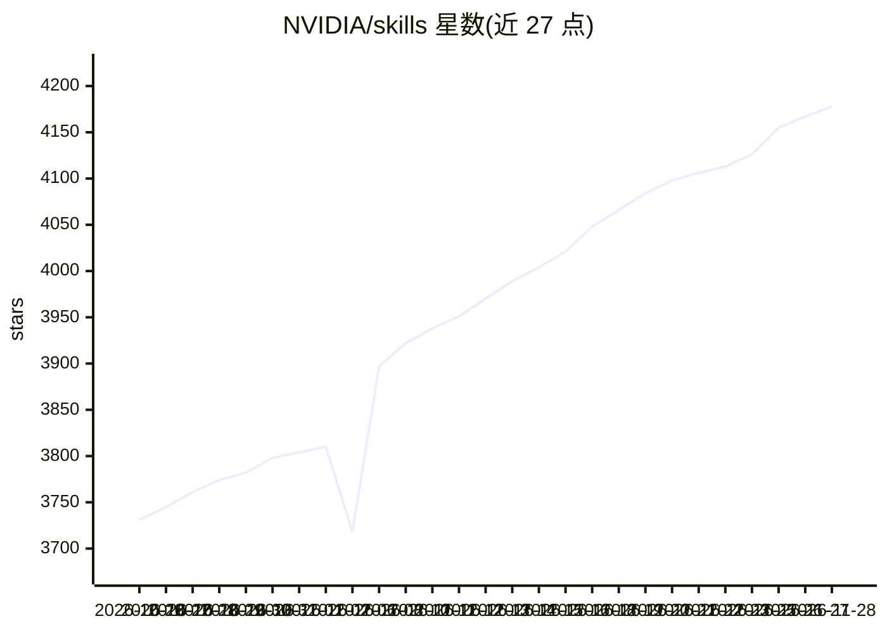

# NVIDIA/skills

⭐ 4,178 · Python · Apache-2.0 · 推送 2026-11-27 · [GitHub](https://github.com/NVIDIA/skills) · [官网](https://docs.nvidia.com/skills) · 组织维护

**NVIDIA 官方 Agent 技能与插件目录，装入编码 agent 使用**

NVIDIA 维护的 Agent Skills 与 Plugins 目录：skills 是教授 AI agent 使用 NVIDIA 软件（Physical AI、仿真、CUDA-X、RAG 等）的可移植指令集，plugins 将某产品的技能连同所需 MCP 服务器打包为单一安装。技能在各自产品仓库维护并每日自动镜像至此，发布前经过签名、扫描与评估。通过 skills CLI 安装到 Claude Code、Codex、Cursor 等编码 agent，支持多 agent 批量安装与更新。

## 筛选速览

| 维度 | 判定 | 备注 |
|---|---|---|
| AI 角色 | `ai-knowledge` | 知识聚合/清单类 |
| 许可风险 | `permissive` | Apache-2.0 |
| 部署形态 | `self-host` | docker 或自建部署 |
| 模型依赖 | — | README 未给出锁定关系 |
| 硬件要求 | — | 无带数字的原话,不猜 |
| 安装摩擦 | `low` | 无编译、无系统依赖或容器化 |
| 成熟度 | — | 结构信号不足 |

## 能力要点

- skills CLI 一条命令安装技能到多种编码 agent，支持 --agent 多次指定
- NVIDIA Verified Plugins 打包产品技能与本地 MCP 服务器
- 技能每日自动同步镜像，发布前签名、扫描并评估
- nvidia-skill-finder 技能可搜索目录并推荐匹配技能

## 适用场景

- 让 Claude Code/Codex 按官方指引调用 cuOpt 等 NVIDIA 工具链
- 为使用 CUDA-X 库的开发工作流配置 agent 技能
- 批量把同一套 NVIDIA 技能安装进多个 agent

## 场景标签

`编码 Agent` `Agent 框架` · 领域:Agent 开发

## 证据(README 行号)

> L15: Skills are portable instruction sets that teach AI agents how to use NVIDIA software optimally: Physical AI and rob
> L17: This repository is a catalog of both. Skills are maintained in their respective product repos and mirrored here dai

## 星数曲线

2026-10-26 3,731 → 2026-11-28 4,178（+447）

---
*卡片 v1 · prompt 1.4 · 生成 2026-11-27 · 置信度 mid · 依据 README sha `89cca8be3ce5` · [字段定义](../../DATASET.md)*
