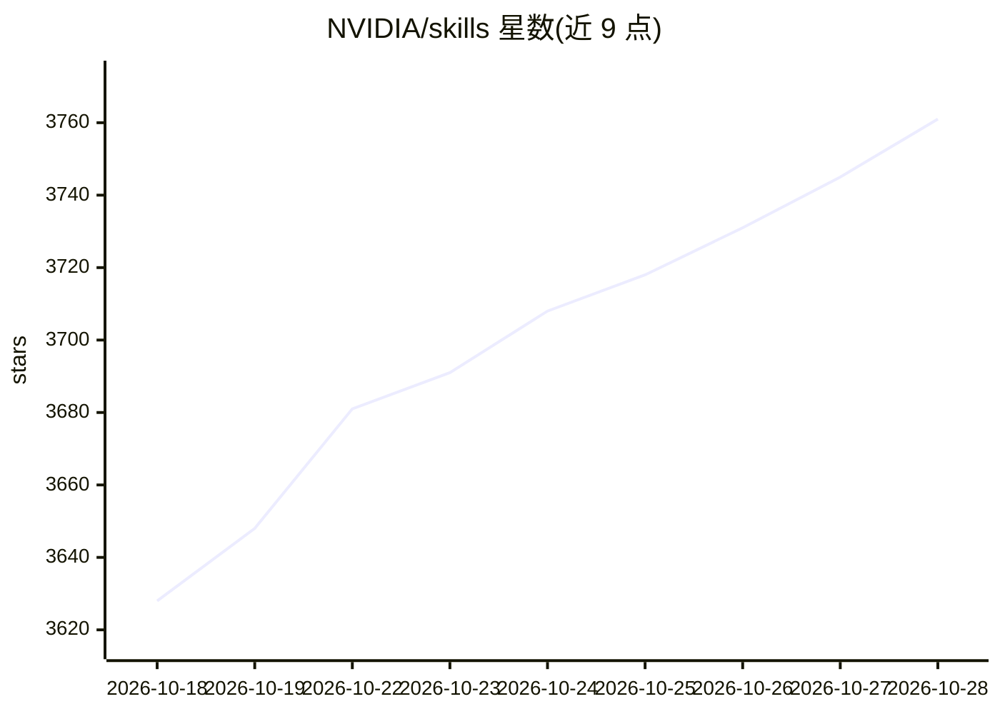

# NVIDIA/skills

⭐ 3,761 · Python · Apache-2.0 · 推送 2026-10-27 · [GitHub](https://github.com/NVIDIA/skills) · [官网](https://docs.nvidia.com/skills) · 组织维护

**NVIDIA 官方验证的 Agent Skills 目录，装给编码 agent 使用**

NVIDIA 维护的 Agent Skills 聚合目录：技能本体保存在各产品仓库，经自动化同步管道每日镜像到本仓库。技能以可移植指令集形式教 AI agent 使用 NVIDIA 软件，覆盖 Physical AI 与机器人、仿真、CUDA-X 库、RAG 与 AI Blueprints 及平台工具。通过 npx skills CLI 安装到 Claude Code、Codex、Cursor、Kiro 等编码 agent，支持交互式选择、免提示安装、多 agent 目标与更新检查；目录表按产品（BioNeMo、cuOpt、DOCA、Holoscan 等）组织技能条目。

## 筛选速览

| 维度 | 判定 | 备注 |
|---|---|---|
| AI 角色 | `ai-knowledge` | 知识聚合/清单类 |
| 许可风险 | `permissive` | Apache-2.0 |
| 部署形态 | `self-host` | docker 或自建部署 |
| 模型依赖 | — | README 未给出锁定关系 |
| 硬件要求 | — | 无带数字的原话,不猜 |
| 安装摩擦 | `low` | 无编译、无系统依赖或容器化 |
| 成熟度 | — | 结构信号不足 |

## 能力要点

- 技能保存在各产品仓库，每日自动镜像同步
- npx skills CLI 安装到 Claude Code/Codex/Cursor/Kiro 等多种编码 agent
- 目录按产品分类，覆盖 BioNeMo、cuOpt、DOCA、Holoscan、Earth2Studio 等
- 提供 update/list/check 命令管理已安装技能并标记上游合并或移除

## 适用场景

- 给 Claude Code 或 Codex 等 agent 添加 NVIDIA 软件的使用技能
- 用自然语言让 agent 调用 cuOpt 等 NVIDIA API 完成任务
- 浏览 NVIDIA 各产品的可用 agent 技能目录

## 场景标签

`精选清单` · 领域:学习与行业

## 证据(README 行号)

> L13: Skills are portable instruction sets that teach AI agents how to use NVIDIA software optimally: Physical AI and rob
> L20: npx skills add nvidia/skills

## 星数曲线

2026-10-18 3,628 → 2026-10-28 3,761（+133）

---
*卡片 v1 · prompt 1.4 · 生成 2026-10-20 · 置信度 mid · 依据 README sha `c97032943f3a` · [字段定义](../../DATASET.md)*
