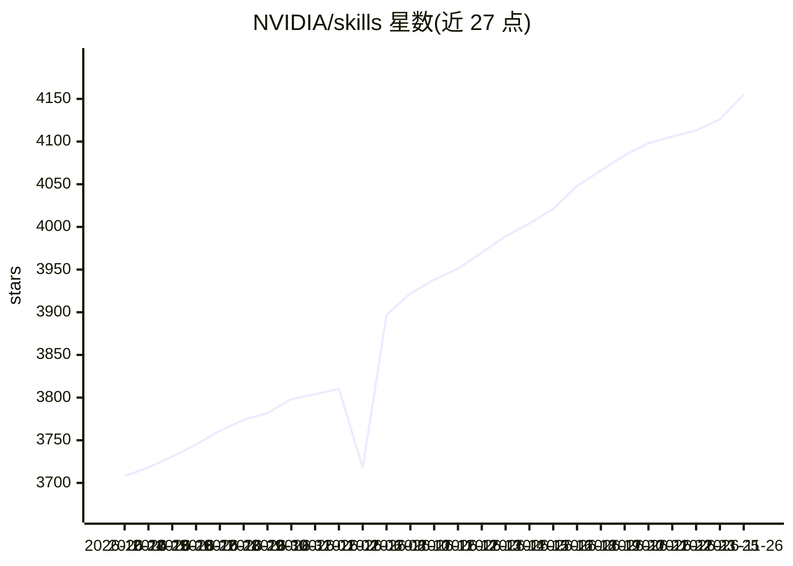

# NVIDIA/skills

⭐ 4,155 · Python · Apache-2.0 · 推送 2026-11-25 · [GitHub](https://github.com/NVIDIA/skills) · [官网](https://docs.nvidia.com/skills) · 组织维护

**NVIDIA 官方 agent 技能与插件目录，装入编码 agent 使用**

NVIDIA 维护的 Agent Skills 与 Plugins 目录：技能是教会 AI agent 正确使用 NVIDIA 软件的便携指令集，覆盖 Physical AI/机器人、仿真、CUDA-X 库、RAG 与平台工具；插件将某产品的技能连同所需的本地 MCP 服务器打包为单一安装。技能从各产品仓库每日自动同步镜像至此，发布前经签名、扫描与评估。通过 skills CLI（npm 分发）按 agent（Claude Code/Codex/Cursor 等）安装，或经各 agent 插件市场安装 Verified Plugin，需 CLI v1.5.16 以上。

## 筛选速览

| 维度 | 判定 | 备注 |
|---|---|---|
| AI 角色 | `ai-ecosystem` | LLM/agent 周边工具 |
| 许可风险 | `permissive` | Apache-2.0 |
| 部署形态 | `self-host` | docker 或自建部署 |
| 模型依赖 | — | README 未给出锁定关系 |
| 硬件要求 | — | 无带数字的原话,不猜 |
| 安装摩擦 | `low` | 无编译、无系统依赖或容器化 |
| 成熟度 | — | 结构信号不足 |

## 能力要点

- 技能每日从各产品仓库自动同步镜像到本目录
- 每个技能与 Verified Plugin 发布前经签名、扫描与评估
- skills CLI 支持向多个 agent 批量安装同一技能
- NVIDIA Skill Finder 按用例搜索并推荐所需技能

## 适用场景

- 让编码 agent 按 NVIDIA 官方指引调用 cuOpt、cuDF 等库完成工作流
- 在 Claude Code/Codex/Cursor 中一键安装整套 NVIDIA 产品技能包
- 搭建需要使用 NVIDIA 软件（BioNeMo、DeepStream 等）的 agent 工作流

## 场景标签

`提示工程` · 领域:Agent 开发

## 证据(README 行号)

> L15: Skills are portable instruction sets that teach AI agents how to use NVIDIA software optimally: Physical AI and rob
> L17: This repository is a catalog of both. Skills are maintained in their respective product repos and mirrored here dai
> L21: Install individual **skills** with the `skills` CLI, or install a whole product toolset as an NVIDIA Verified **plu

## 星数曲线

2026-10-24 3,708 → 2026-11-26 4,155（+447）

---
*卡片 v1 · prompt 1.4 · 生成 2026-11-26 · 置信度 low · 依据 README sha `c0cefcd26fc2` · [字段定义](../../DATASET.md)*
