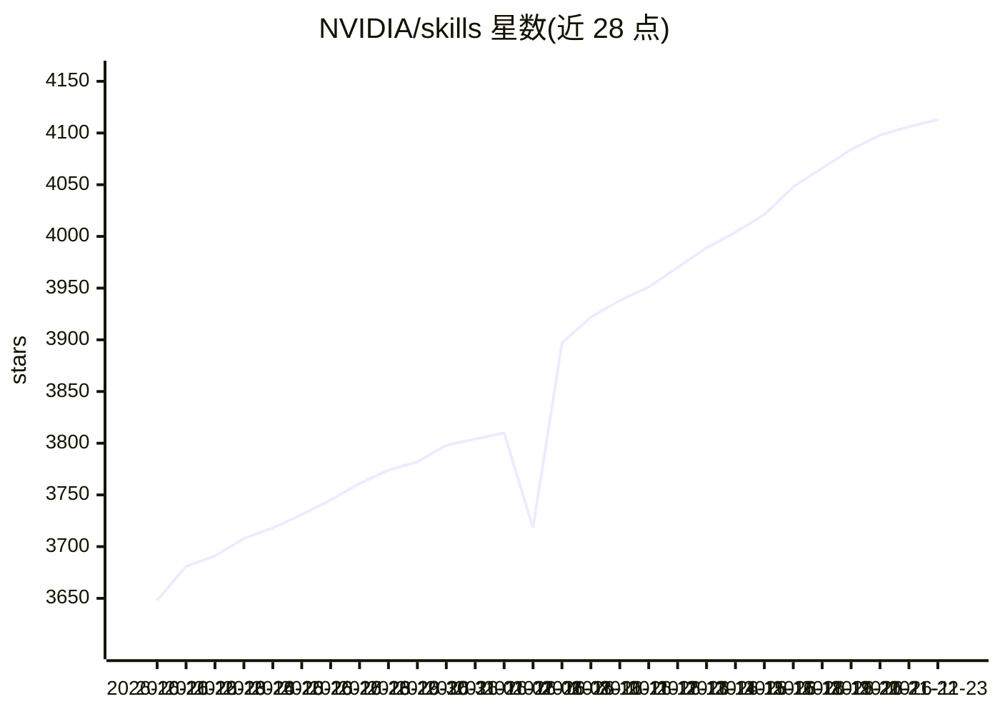

# NVIDIA/skills

⭐ 4,113 · Python · Apache-2.0 · 推送 2026-11-20 · [GitHub](https://github.com/NVIDIA/skills) · [官网](https://docs.nvidia.com/skills) · 组织维护

**NVIDIA 官方 Agent 技能目录：教 AI 编码代理使用 NVIDIA 软件**

由 NVIDIA 维护并每日从各产品仓库自动同步的 Agent Skills 目录：技能以可移植指令集形式教会 Claude Code、Codex 等 AI 编码代理使用 NVIDIA 软件，覆盖 Physical AI 与机器人、仿真、CUDA-X 库、RAG 与 AI Blueprints 及平台工具。通过 `skills` CLI（npx）安装，支持按技能名、按目标代理（claude-code/codex/cursor 等）安装，提供技能查找器、目录浏览、更新与失效清理命令。技能本体在各产品仓库维护，要求 skills CLI v1.5.16 以上。

## 筛选速览

| 维度 | 判定 | 备注 |
|---|---|---|
| AI 角色 | `ai-knowledge` | 知识聚合/清单类 |
| 许可风险 | `permissive` | Apache-2.0 |
| 部署形态 | `self-host` | docker 或自建部署 |
| 模型依赖 | — | README 未给出锁定关系 |
| 硬件要求 | — | 无带数字的原话,不猜 |
| 安装摩擦 | `low` | 无编译、无系统依赖或容器化 |
| 成熟度 | — | 结构信号不足 |

## 能力要点

- 每日自动同步的产品技能镜像目录，持续新增
- skills CLI 支持按技能与按目标代理（--agent）安装，可多代理同时安装
- 内置 Skill Finder 技能用于搜索目录并安装其他技能
- 提供 update/list/check 命令管理已安装技能及上游合并/移除的清理

## 适用场景

- 让编码代理按技能指引调用 cuOpt 求解线性规划
- 为 Claude Code/Codex 等代理安装 NVIDIA 产品工作流技能
- 浏览 NVIDIA 全系产品可用的 agent 技能清单

## 场景标签

`编码 Agent` · 领域:编码与开发

## 证据(README 行号)

> L13: Skills are portable instruction sets that teach AI agents how to use NVIDIA software optimally: Physical AI and rob
> L17: Install NVIDIA skills with the default `skills` CLI flow. The NVIDIA Skill Finder skill will search this catalog an
> L104: ## Skill Catalog

## 星数曲线

2026-10-21 3,648 → 2026-11-23 4,113（+465）

---
*卡片 v1 · prompt 1.4 · 生成 2026-11-23 · 置信度 mid · 依据 README sha `72151cd08fca` · [字段定义](../../DATASET.md)*
