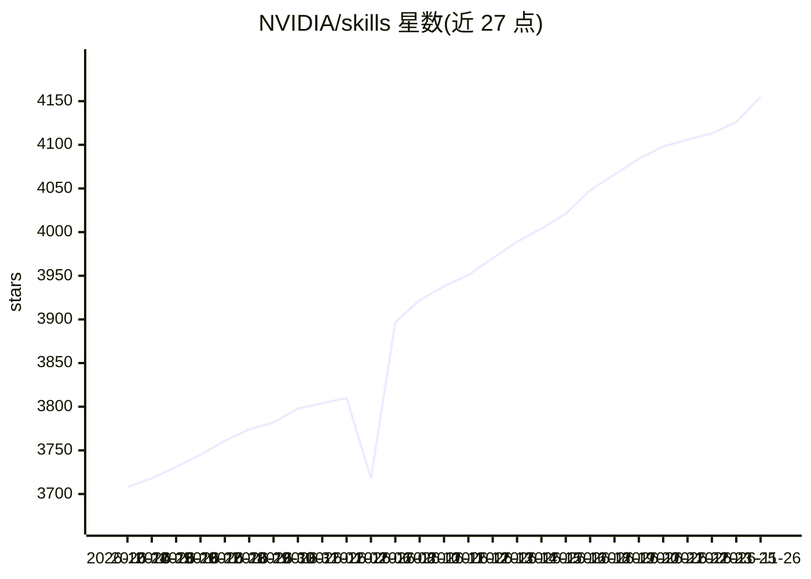

# NVIDIA/skills

⭐ 4,155 · Python · Apache-2.0 · 推送 2026-11-25 · [GitHub](https://github.com/NVIDIA/skills) · [官网](https://docs.nvidia.com/skills) · 组织维护

**为编码 Agent 安装 NVIDIA 产品技能的官方目录**

NVIDIA 官方维护的 Agent Skills 目录，收录可移植的指令集，教 AI 编码代理使用 NVIDIA 软件：Physical AI 与机器人工作流、仿真、CUDA-X 库、RAG 与 AI Blueprints 及平台工具。技能在各产品仓库维护，经自动同步管道每日镜像至此。通过 skills CLI（npx）安装，支持指定 Claude Code、Codex、Cursor、Kiro、Snowflake CoCo 等目标代理，提供 Skill Finder 技能检索、批量安装、更新与上游合并清理，需 CLI v1.5.16 及以上。

## 筛选速览

| 维度 | 判定 | 备注 |
|---|---|---|
| AI 角色 | `ai-knowledge` | 知识聚合/清单类 |
| 许可风险 | `permissive` | Apache-2.0 |
| 部署形态 | `self-host` | docker 或自建部署 |
| 模型依赖 | locked-api |  |
| 硬件要求 | — | 无带数字的原话,不猜 |
| 安装摩擦 | `low` | 无编译、无系统依赖或容器化 |
| 成熟度 | — | 结构信号不足 |

## 能力要点

- 覆盖 CUDA-X（cuDF/cuML/cuOpt/DALI 等）、BioNeMo、Cosmos Data Factory、DeepStream、DOCA 等产品线技能
- skills CLI 支持 --agent 定向安装到多个编码代理并可一次多目标
- 提供 Skill Finder 技能用于目录内检索与安装
- 自动同步管道每日镜像，npx skills update 支持更新与失效技能清理

## 适用场景

- 让 Claude Code/Codex 等代理按 NVIDIA 官方指引运行 cuOpt 求解、cuDF 加速等工作流
- 为分子模拟或药物发现任务检索并安装 BioNeMo 相关技能
- 在 Kubernetes 上部署 NVIDIA Dynamo 并排查互联问题

## 场景标签

`提示工程` · 领域:Agent 开发

## 证据(README 行号)

> L13: Skills are portable instruction sets that teach AI agents how to use NVIDIA software optimally: Physical AI and rob
> L17: Install NVIDIA skills with the default `skills` CLI flow. The NVIDIA Skill Finder skill will search this catalog an

## 星数曲线

2026-10-24 3,708 → 2026-11-26 4,155（+447）

---
*卡片 v1 · prompt 1.4 · 生成 2026-11-24 · 置信度 low · 依据 README sha `53590b5f8c76` · [字段定义](../../DATASET.md)*
