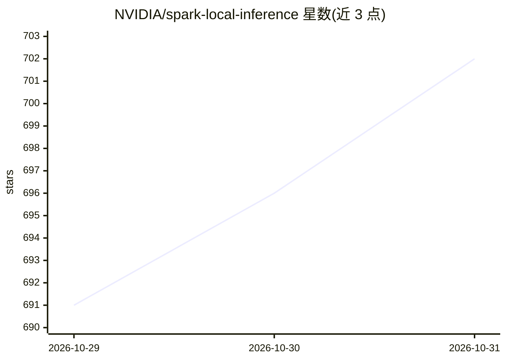

# NVIDIA/spark-local-inference

⭐ 702 · Rust · Apache-2.0 · 推送 2026-10-30 · [GitHub](https://github.com/NVIDIA/spark-local-inference) · 组织维护

**面向 NVIDIA SM120/121 GPU 的本地推理服务器，服务长对话与编码代理**

Flare（spark-local-inference）是 NVIDIA 开源的本地推理服务器，面向 SM120/SM121 GPU 工作站及 DGX Spark 等紧凑系统，服务长对话、编码代理与反复工具调用。机制上分两段：Ignition 基于 PyTorch/Transformers/FlashInfer 完成模型加载、核调优、前向编译与 CUDA graph 捕获，打包后由 Rust 运行时 Helios 无 Python 服务。明确为研究原型，声明不替代 vLLM 等生产推理引擎，模型与部署范围聚焦。

## 筛选速览

| 维度 | 判定 | 备注 |
|---|---|---|
| AI 角色 | `ai-ecosystem` | LLM/agent 周边工具 |
| 许可风险 | `permissive` | Apache-2.0 |
| 部署形态 | `None` |  |
| 模型依赖 | — | README 未给出锁定关系 |
| 硬件要求 | — | 无带数字的原话,不猜 |
| 安装摩擦 | `medium` | 含编译或系统依赖之一 |
| 成熟度 | `idea` | |

## 能力要点

- PyTorch 生态构建 + Rust 运行时（Helios）无 Python 服务
- CUDA graph 捕获与服务前完成编译
- 将 KV cache 与循环状态作为整体管理，支持复用/分支/恢复
- 面向长对话与编码代理的本地工作负载优化

## 适用场景

- 在 DGX Spark 等 SM120/121 设备上本地运行选定模型服务编码代理
- 需要长对话与反复工具调用场景下保持生成响应性

## 场景标签

`推理引擎` · 领域:训练与推理

## 证据(README 行号)

> L5: Flare is a local inference server for NVIDIA SM120/SM121 GPUs, built for
> L6: long conversations, coding agents, and repeated tool use. Its goal is to make
> L18:  Helios, the Rust runtime, serves that package without Python. Compilation and

## 星数曲线

2026-10-29 691 → 2026-10-31 702（+11）

---
*卡片 v1 · prompt 1.4 · 生成 2026-10-30 · 置信度 high · 依据 README sha `3298238b6b04` · [字段定义](../../DATASET.md)*
