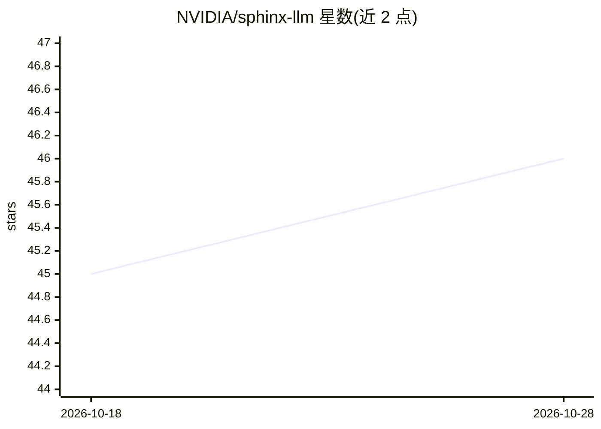

# NVIDIA/sphinx-llm

⭐ 46 · Python · Apache-2.0 · 推送 2026-10-24 · [GitHub](https://github.com/NVIDIA/sphinx-llm) · [官网](https://sphinx-llm.readthedocs.io) · 组织维护

**让 Sphinx 文档生成 LLM 可读输出并在构建中调用 LLM 的扩展集**

NVIDIA 维护的 Sphinx 扩展包，含两类工具：一是按 llms.txt v2 标准在构建时自动生成 Markdown 版页面、llms.txt 索引与可选 llms-full.txt，供 LLM 与 agent 检索消费，支持 append/replace/auto 三种输出布局、嵌套索引与 HTML 发现元数据；二是在构建过程中调用 OpenAI 兼容接口生成页面一句话摘要（可配置模型、base_url、缓存与超时）。通过 pip 安装，生成类功能需额外安装 [gen] 附加项；仅支持 HTML 类构建器。

## 筛选速览

| 维度 | 判定 | 备注 |
|---|---|---|
| AI 角色 | `ai-ecosystem` | LLM/agent 周边工具 |
| 许可风险 | `permissive` | Apache-2.0 |
| 部署形态 | `library` | 以包/库形式分发 |
| 模型依赖 | — | README 未给出锁定关系 |
| 硬件要求 | — | 无带数字的原话,不猜 |
| 安装摩擦 | `low` | 无编译、无系统依赖或容器化 |
| 成熟度 | — | 结构信号不足 |

## 能力要点

- 构建时自动生成 llms.txt 索引与各页 Markdown（append/replace/auto 布局）
- human/agent 受众标签可对同一文档输出差异化内容
- 调用 OpenAI 兼容接口为每页生成一句话描述（含缓存与超时配置）
- HTML 页面 head 注入 alternate/describedby 发现链接

## 适用场景

- 让项目的 Sphinx 文档被 LLM 与 agent 更好地索引和检索
- 为文档同时维护人类版与 agent 版内容
- 构建时自动生成各页摘要而非人工撰写

## 场景标签

 · 领域:文档工具/LLM 基础设施

## 证据(README 行号)

> L3: The `sphinx-llm` package includes a collection of
> L8: - **Enabling LLMs and agents to consume your docs** - Produces additional build
> L12: - **Leveraging LLMs to generate content dynamically during the Sphinx build** -

## 星数曲线

2026-10-18 45 → 2026-10-28 46（+1）

---
*卡片 v1 · prompt 1.4 · 生成 2026-10-25 · 置信度 high · 依据 README sha `3576ac64ca69` · [字段定义](../../DATASET.md)*
