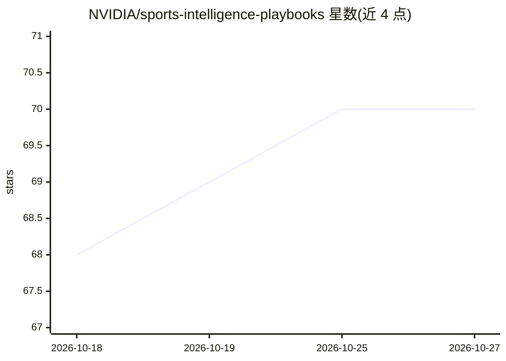

# NVIDIA/sports-intelligence-playbooks

⭐ 70 · Python · Apache-2.0 · 推送 2026-10-02 · [GitHub](https://github.com/NVIDIA/sports-intelligence-playbooks) · [官网](https://nvidia.github.io/sports-intelligence-playbooks/latest/) · 组织维护

**面向体育领域的多模态 LLM 训练/推理/评测起步套件**

基于 NVIDIA AI 栈（NeMo AutoModel 与 Megatron-Bridge 两套可互换的训练栈）的体育智能 AVLM 起步套件：覆盖数据标注、QA/MCQ 数据准备、SFT/LoRA 训练、推理与评测（逐类 MCQ + LLM-judge）的端到端流程，提供 Slurm 与本地通用启动脚本、HF↔Megatron checkpoint 转换与超参搜索。当前配置仅对参考模型测试通过，脚本可复用于体育之外的多模态任务；需配合 NGC 容器运行，解码二进制（FFmpeg 等）不随仓库分发。

## 筛选速览

| 维度 | 判定 | 备注 |
|---|---|---|
| AI 角色 | `ai-ecosystem` | LLM/agent 周边工具 |
| 许可风险 | `permissive` | Apache-2.0 |
| 部署形态 | `self-host` | docker 或自建部署 |
| 模型依赖 | — | README 未给出锁定关系 |
| 硬件要求 | — | 无带数字的原话,不猜 |
| 安装摩擦 | `low` | 无编译、无系统依赖或容器化 |
| 成熟度 | — | 结构信号不足 |

## 能力要点

- 标注→数据准备→SFT/LoRA→推理→评测的端到端流程
- NeMo AutoModel 与 Megatron-Bridge 两套可互换训练/推理栈
- Slurm 与本地通用启动脚本，支持多节点 sbatch
- 逐类 MCQ 评测 + LLM-judge 评测流水线

## 适用场景

- 对体育视频/音频数据做多模态模型微调与评测
- 复用脚本构建其他领域的多模态训练流程
- 在 Slurm 集群上做分布式 SFT/LoRA 训练

## 场景标签

`多模态` `微调` `模型评测` · 领域:评测与运维

## 证据(README 行号)

> L5: This repository provides a starter kit for sports-intelligence built on **NVIDIA AI stack**: playbooks, training rec
> L31: - **NeMo AutoModel** — full SFT and LoRA; generic (local) and Slurm launchers; container `nemo-automodel:26.06.00`.
> L32: - **Megatron-Bridge** — full SFT and LoRA; generic (local) and Slurm launchers; container `nemo:26.06.00`.

## 星数曲线

2026-10-18 68 → 2026-10-27 70（+2）

---
*卡片 v1 · prompt 1.4 · 生成 2026-10-24 · 置信度 high · 依据 README sha `7330a45ff3ee` · [字段定义](../../DATASET.md)*
