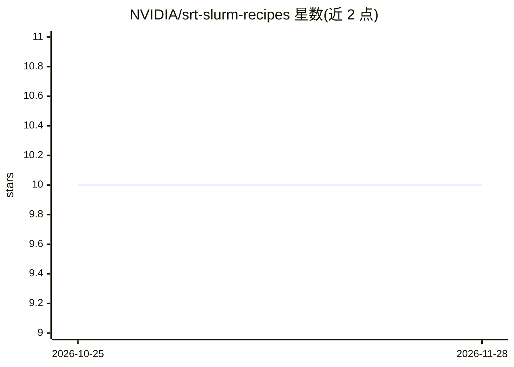

# NVIDIA/srt-slurm-recipes

⭐ 10 · Python · Apache-2.0 · 推送 2026-09-18 · [GitHub](https://github.com/NVIDIA/srt-slurm-recipes) · 组织维护

**为 Slurm 集群 LLM 基准测试提供官方 sweep 配置仓库**

NVIDIA 官方维护的 srt-slurm sweep 配置源仓库：基准执行逻辑在上游 NVIDIA/srt-slurm，本仓库按单节点/多节点、模型、GPU 平台、推理框架的组合组织 YAML 配置，覆盖聚合与分离式服务。附脚本生成与校验配方表（update_recipe_table.py、generate_agentx_single_node.py），AgentX 类配方依赖外部 InferenceX 检出与 INFMAX_WORKSPACE 挂载，缺省则无法运行。运行方式是安装上游 srt-slurm 后用 srtctl dry-run/apply 提交配方。

## 筛选速览

| 维度 | 判定 | 备注 |
|---|---|---|
| AI 角色 | `ai-ecosystem` | LLM/agent 周边工具 |
| 许可风险 | `permissive` | Apache-2.0 |
| 部署形态 | `library` | 以包/库形式分发 |
| 模型依赖 | local-ok | 支持本地模型 |
| 硬件要求 | — | 无带数字的原话,不猜 |
| 安装摩擦 | `low` | 无编译、无系统依赖或容器化 |
| 成熟度 | — | 结构信号不足 |

## 能力要点

- 按 single-node/multi-node 与模型×GPU平台×框架组合组织的 YAML sweep 配置
- 覆盖 vllm、sglang、trtllm 三种推理框架及 GB200/B200/H100/RTX PRO 6000 等平台
- AgentX 配方基于 SemiAnalysis InferenceX 发布结果生成，需 InferenceX 检出方可运行
- 提供 dry-run 预检命令与 pre-commit 校验钩子

## 适用场景

- 在 Slurm 集群上对大模型做固定 ISL/OSL 的吞吐 sweep 基准
- 复现 InferenceX 发布的 agentic-coding 基准数据点
- 在多节点 GB200 NVL72 等平台对比聚合与分离式服务配置

## 场景标签

`模型评测` · 领域:评测与运维

## 证据(README 行号)

> L3: This repository is the source of truth for official `srt-slurm` sweep configurations across node counts, models, GPU
> L5: The upstream tool is NVIDIA/srt-slurm. Keep benchmark execution logic in that project; keep reusable sweep configura
> L44: These recipes carry the engine configuration only. The client side stays in

## 星数曲线

2026-10-25 10 → 2026-11-28 10（+0）

---
*卡片 v1 · prompt 1.4 · 生成 2026-11-20 · 置信度 mid · 依据 README sha `2368ace3675f` · [字段定义](../../DATASET.md)*
