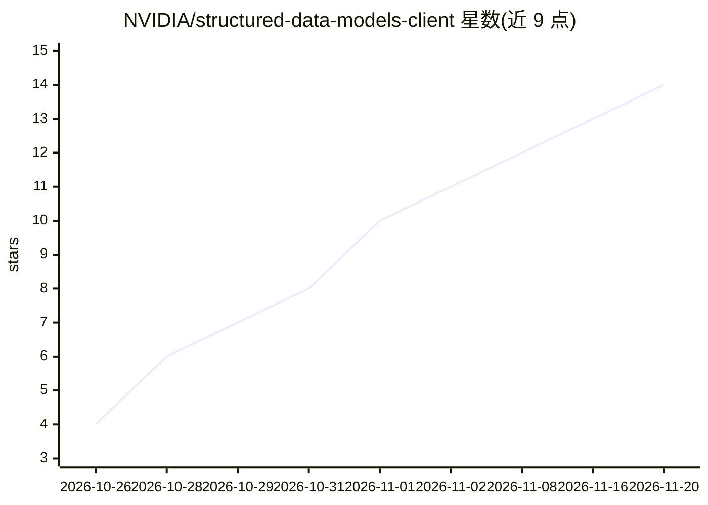

# NVIDIA/structured-data-models-client

⭐ 14 · Python · Apache-2.0 · 推送 2026-11-19 · [GitHub](https://github.com/NVIDIA/structured-data-models-client) · [官网](https://github.com/NVIDIA/structured-data-models-client) · 组织维护

**面向 NVIDIA 表格/关系型基础模型的预测查询 Python 客户端**

该客户端向 NVIDIA 结构化数据基础模型发送预测查询：用户提供带标签的行和待打分行，模型单次上下文推理返回 PredictionResult，可转 pandas DataFrame，无需逐数据集训练。客户端本身不含权重、不要求 GPU，推理在 NIM 推理端点完成，也可通过 SDMClient.in_process() 在本地 Python 进程内运行。提供 kumo-tabular（单表）与 kumo-relational（多表关系图）两种模型入口及 Predictive Query Language。

## 筛选速览

| 维度 | 判定 | 备注 |
|---|---|---|
| AI 角色 | `ai-native` | 本体是模型或模型工具 |
| 许可风险 | `permissive` | Apache-2.0 |
| 部署形态 | `library` | 以包/库形式分发 |
| 模型依赖 | — | README 未给出锁定关系 |
| 硬件要求 | — | 无带数字的原话,不猜 |
| 安装摩擦 | `low` | 无编译、无系统依赖或容器化 |
| 成熟度 | — | 结构信号不足 |

## 能力要点

- 单表（kumo-tabular）与关系图多表（kumo-relational）两种预测模型入口
- in-context 预测：无训练循环、无超参搜索、无逐数据集产物
- 客户端不下载权重、无需 GPU，推理在 NIM 端点或 in-process 运行
- 连接器读取 SQLite/DuckDB/PostgreSQL/Snowflake/Databricks/S3 源表

## 适用场景

- 对单张表格直接提出预测问题并获得打分结果
- 跨多张关联表（关系型数据库模式）做预测查询
- 不训练模型的情况下对仓库/数仓数据做预测分析

## 场景标签

`数据分析` · 领域:效率与自动化

## 证据(README 行号)

> L20: Structured-data foundation models predict in context. You give the model
> L26: inference endpoint, and gives you back a `PredictionResult`, which

## 星数曲线

2026-10-26 4 → 2026-11-20 14（+10）

---
*卡片 v1 · prompt 1.4 · 生成 2026-11-18 · 置信度 high · 依据 README sha `383ea6856fd4` · [字段定义](../../DATASET.md)*
