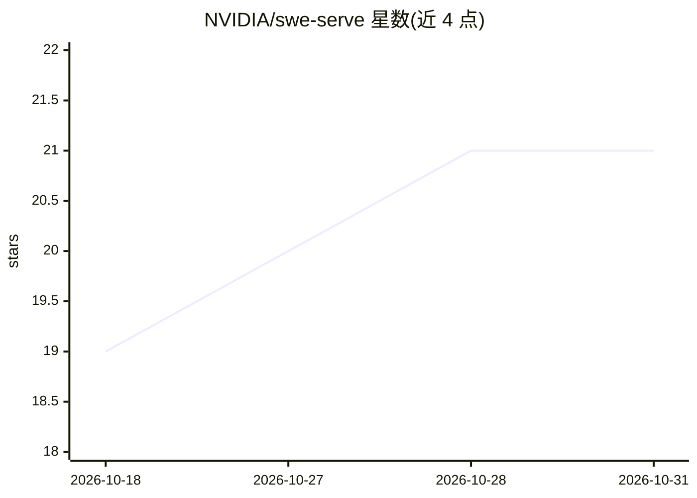

# NVIDIA/swe-serve

⭐ 21 · Python · Apache-2.0 · 推送 2026-10-09 · [GitHub](https://github.com/NVIDIA/swe-serve) · [官网](https://research.nvidia.com/benchmarks/swe-serve) · 组织维护

**生产推理工程任务基准：53 个源自 SGLang PR 的 agent 评测**

NVIDIA 维护的 agentic 基准，包含 53 个源自 SGLang 已合并生产变更的任务（41 个 H100 GPU 任务、12 个 CPU 任务），检验正确性、端到端执行、持久状态与并发请求。基于 Harbor 框架运行，支持 mini-swe-agent harness 通过 OPENAI_BASE_URL/ANTHROPIC_BASE_URL 接入模型端点，提供 closed-book 防查重模式、oracle/nop 校验、论文级 YAML 复现配置。为冻结发布版（frozen release），任务内容按 git 标签固定、不可手工更改。运行需 Linux x86_64、Docker Compose V2+、Python 3.12+、H100 GPU（GPU 任务）及至少 20 核 CPU、128 GiB 内存、建议 1 TB 磁盘。

## 筛选速览

| 维度 | 判定 | 备注 |
|---|---|---|
| AI 角色 | `ai-ecosystem` | LLM/agent 周边工具 |
| 许可风险 | `permissive` | Apache-2.0 |
| 部署形态 | `library` | 以包/库形式分发 |
| 模型依赖 | — | README 未给出锁定关系 |
| 硬件要求 | — | 无带数字的原话,不猜 |
| 安装摩擦 | `low` | 无编译、无系统依赖或容器化 |
| 成熟度 | — | 结构信号不足 |

## 能力要点

- 53 个任务源自 SGLang 生产 PR（41 GPU + 12 CPU）
- Harbor 任务格式，支持单任务或全量运行
- closed-book 模式限制 agent 网络访问并提供审计日志
- oracle/nop agent 用于验证环境正确性

## 适用场景

- 评测 LLM/agent 在生产推理工程任务上的表现
- 复现论文排行榜结果
- 对比不同模型端点在系统工程任务的能力

## 场景标签

`模型评测` · 领域:评测与运维

## 证据(README 行号)

> L5: SWE-Serve evaluates LLMs/agents on production inference engineering tasks. The benchmark includes
> L6: 53 tasks derived from recent production changes to SGLang: 41 GPU (H100) tasks and 12 CPU tasks.
> L156: SWE-Serve tasks use the Harbor task format.

## 星数曲线

2026-10-18 19 → 2026-10-31 21（+2）

---
*卡片 v1 · prompt 1.4 · 生成 2026-10-28 · 置信度 high · 依据 README sha `682bdcc94004` · [字段定义](../../DATASET.md)*
