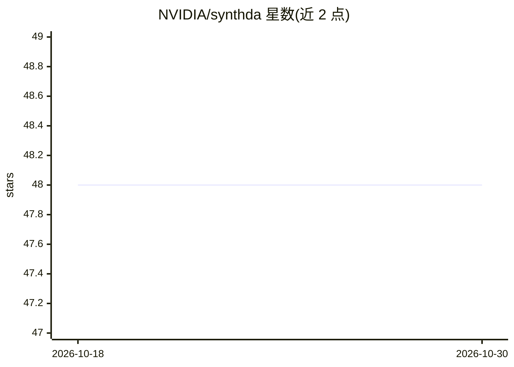

# NVIDIA/synthda

⭐ 48 · Jupyter Notebook · 推送 2026-02-25 · [GitHub](https://github.com/NVIDIA/synthda) · 组织维护

**姿态级合成数据增强框架：为动作识别生成少数类训练视频**

SynthDa 是 NVIDIA 与新加坡理工学院合作的合成数据增强工具包：通过对真实姿态与 AI 生成姿态做插值（而非渲染完整照片级画面），仅用 RGB 视频即可生成类别均衡、运动学合理的视频片段，缓解动作识别数据集的少数类不平衡问题。各组件可替换为用户自选模型，优化循环使用 NVIDIA TAO Toolkit 的动作识别网络。许可为 NSCLv2，限非商业用途且仅支持 NVIDIA 处理器上开发测试。安装需 pip 安装依赖、克隆 5 个外部仓库、配置 OpenAI key 并下载模型 checkpoint。

## 筛选速览

| 维度 | 判定 | 备注 |
|---|---|---|
| AI 角色 | `ai-native` | 本体是模型或模型工具 |
| 许可风险 | `none` | — |
| 部署形态 | `library` | 以包/库形式分发 |
| 模型依赖 | — | README 未给出锁定关系 |
| 硬件要求 | — | 无带数字的原话,不猜 |
| 安装摩擦 | `medium` | 含编译或系统依赖之一 |
| 成熟度 | — | 结构信号不足 |

## 能力要点

- 姿态插值生成合成视频，仅需 RGB 视频、无需额外传感器
- 各组件可单独使用或串联自动化，可替换为自选模型
- 优化循环使用 NVIDIA TAO Toolkit 动作识别网络
- 提供 HuggingFace Spaces 演示与 Colab notebook

## 适用场景

- 动作识别数据集少数类样本不足时做数据增强
- 研究人员生成类别均衡的运动学合理合成视频
- 在 Colab 或本地 NVIDIA GPU 上试验姿态级合成数据流水线

## 场景标签

`视频生成` · 领域:内容生成

## 证据(README 行号)

> L17: **SynthDa** (aka **AutoSynthDa**) is an open-source toolkit that generates class-balanced, kinematically valid vide
> L19: Each component of our proposed framework can be swapped with models of your choice or components of your choice. Fo

## 星数曲线

2026-10-18 48 → 2026-10-30 48（+0）

---
*卡片 v1 · prompt 1.4 · 生成 2026-10-25 · 置信度 high · 依据 README sha `35eaba52999a` · [字段定义](../../DATASET.md)*
