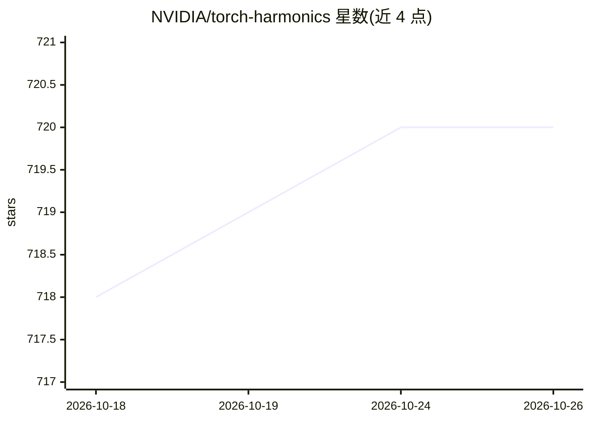

# NVIDIA/torch-harmonics

⭐ 720 · Jupyter Notebook · BSD-3-Clause · 推送 2026-10-21 · [GitHub](https://github.com/NVIDIA/torch-harmonics) · 组织维护

**球面可微信号处理库：为 PyTorch 提供球谐变换等算子**

NVIDIA 维护的 PyTorch 库，提供球面上可微信号算子：球谐变换（SHT）、向量球谐变换、离散-连续卷积（DISCO）与球面注意力机制，全部以 torch.nn.Module 形式提供以支持组合使用。SHT 用求积规则与 FFT 实现，可分布式到多 rank 做空间并行。支持等角、Legendre-Gauss、HEALPix 等多种网格描述符。最初为球面傅里叶神经算子（SFNO）实现，已被用于多个可微 PDE 求解器。CPU 版经 PyPI 安装，GPU 版需从 pypi.nvidia.com 安装对应 CUDA 版本的 wheel，或从源码编译。

## 筛选速览

| 维度 | 判定 | 备注 |
|---|---|---|
| AI 角色 | `ai-ecosystem` | LLM/agent 周边工具 |
| 许可风险 | `permissive` | BSD-3-Clause |
| 部署形态 | `self-host` | docker 或自建部署 |
| 模型依赖 | — | README 未给出锁定关系 |
| 硬件要求 | `cpu-ok` | |
| 安装摩擦 | `low` | 无编译、无系统依赖或容器化 |
| 成熟度 | — | 结构信号不足 |

## 能力要点

- 可微的球谐变换/向量球谐变换实现，基于 PyTorch 原语
- 球面离散-连续卷积（DISCO）与球面邻域注意力机制
- 支持 5 种网格描述符（含 HEALPix），网格间可互映射
- 分布式 SHT 支持多 rank 空间划分与模型并行

## 适用场景

- 构建球面数据上的神经算子或 PDE 求解器
- 气候/地球科学球面网格数据的可微变换与卷积
- 在 HEALPix 天文网格上做注意力与卷积运算

## 场景标签

 · 领域:科学计算/可微球面信号处理

## 证据(README 行号)

> L16: torch-harmonics implements differentiable signal processing on the sphere. This includes differentiable implementat
> L20: torch-harmonics uses PyTorch primitives to implement these operations, making it fully differentiable. Moreover, th

## 星数曲线

2026-10-18 718 → 2026-10-26 720（+2）

---
*卡片 v1 · prompt 1.4 · 生成 2026-10-21 · 置信度 high · 依据 README sha `18258e050e57` · [字段定义](../../DATASET.md)*
