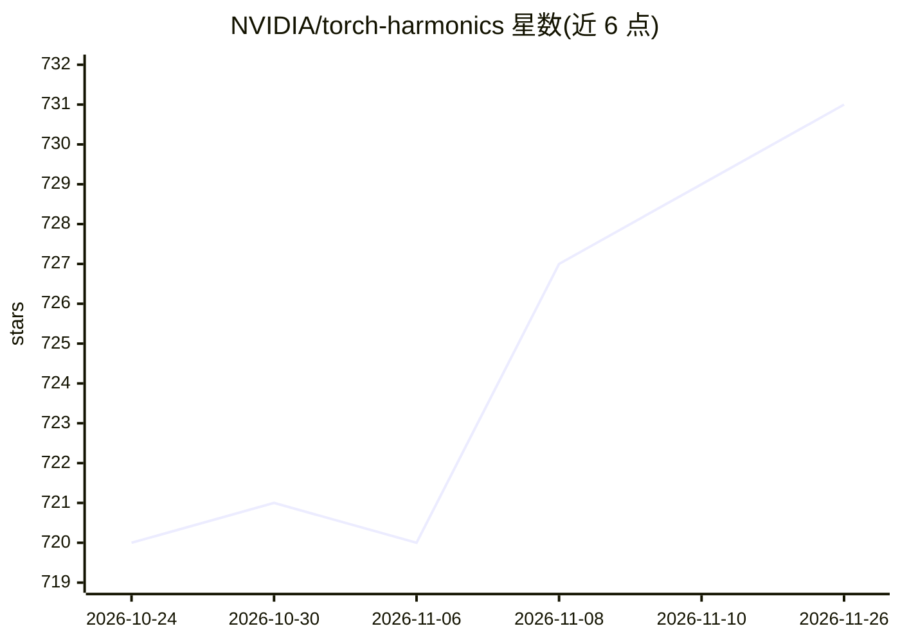

# NVIDIA/torch-harmonics

⭐ 731 · Jupyter Notebook · BSD-3-Clause · 推送 2026-11-25 · [GitHub](https://github.com/NVIDIA/torch-harmonics) · 组织维护

**PyTorch 球面可微信号处理库，服务球面深度学习建模**

torch-harmonics 在 PyTorch 中实现球面上的可微信号处理，包括球谐变换（SHT）、矢量球谐变换和球面离散-连续（DISCO）卷积，并以 torch.nn.Module 形式提供以便组合；变换基于求积规则加 FFT，可在多 rank 上空间分布式执行。该包最初为支持球面傅里叶神经算子（SFNO）而实现，也已被用于构建可微 PDE 求解器。安装上提供含 CUDA 扩展的预编译 Linux wheel（按 CUDA 版本）、CPU-only wheel、源码编译与 Docker 容器四种途径；自定义 CUDA 扩展要求 GPU 架构 ≥ 7.0。

## 筛选速览

| 维度 | 判定 | 备注 |
|---|---|---|
| AI 角色 | `ai-native` | 本体是模型或模型工具 |
| 许可风险 | `permissive` | BSD-3-Clause |
| 部署形态 | `self-host` | docker 或自建部署 |
| 模型依赖 | — | README 未给出锁定关系 |
| 硬件要求 | `cpu-ok` | |
| 安装摩擦 | `low` | 无编译、无系统依赖或容器化 |
| 成熟度 | — | 结构信号不足 |

## 能力要点

- 提供可微的球谐变换与矢量球谐变换实现
- 提供球面 DISCO 卷积与球面（邻域）注意力机制
- 支持多种网格类型（Equiangular/Fejér-1/Legendre-Gauss/Lobatto/Trapezoidal/HEALPix）
- 求积可分布到多 rank，实现空间分布式计算

## 适用场景

- 为球面数据（如气象/气候再分析场）构建神经网络层
- 实现球面上的可微 PDE 求解器
- 开发 SFNO 等球面神经算子模型
- 处理 HEALPix 等结构化与非结构化球面网格数据

## 场景标签

 · 领域:科学计算/深度学习库

## 证据(README 行号)

> L16: torch-harmonics implements differentiable signal processing on the sphere. This includes differentiable implementat
> L22: torch-harmonics has been used to implement a variety of differentiable PDE solvers which generated the animations b
> L161: The main functionality of `torch_harmonics` is provided in the form of `torch.nn.Modules` for composability. A min

## 星数曲线

2026-10-24 720 → 2026-11-26 731（+11）

---
*卡片 v1 · prompt 1.4 · 生成 2026-11-24 · 置信度 high · 依据 README sha `2dd8038e11e3` · [字段定义](../../DATASET.md)*
