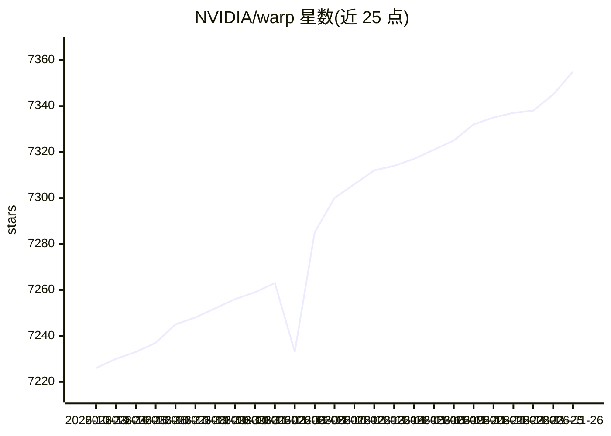

# NVIDIA/warp

⭐ 7,355 · Python · Apache-2.0 · 推送 2026-11-25 · [GitHub](https://github.com/NVIDIA/warp) · [官网](https://nvidia.github.io/warp/stable/) · 组织维护

**面向仿真、机器人与 ML 的 GPU 加速 Python 框架**

Warp 将常规 Python 函数 JIT 编译为可运行于 CPU 或 GPU 的内核代码，内置物理仿真、机器人、几何处理等原语；内核可微，可嵌入 PyTorch、JAX、Paddle 的机器学习流水线。通过 PyPI 发布 warp-lang 轮子（Windows/Linux/macOS），CUDA 加速需 R580+ 驱动与 Turing 及更新 GPU，macOS 仅支持 CPU；Windows/Linux CUDA 路径依赖 CUDA Toolkit 13.4，CUDA 12 环境需专用轮子或源码构建。Apache-2.0 许可。

## 筛选速览

| 维度 | 判定 | 备注 |
|---|---|---|
| AI 角色 | `ai-ecosystem` | LLM/agent 周边工具 |
| 许可风险 | `permissive` | Apache-2.0 |
| 部署形态 | `library` | 以包/库形式分发 |
| 模型依赖 | — | README 未给出锁定关系 |
| 硬件要求 | — | 无带数字的原话,不猜 |
| 安装摩擦 | `medium` | 含编译或系统依赖之一 |
| 成熟度 | — | 结构信号不足 |

## 能力要点

- Python 函数 JIT 编译为 CPU/GPU 内核
- 可微内核，可接入 PyTorch/JAX/Paddle 流水线
- 内置物理仿真、机器人、几何处理原语与示例库
- 提供 Colab 教程笔记本与 tile 式 GPU 编程示例

## 适用场景

- 构建 GPU 加速的物理仿真与机器人模拟
- 将可微仿真嵌入机器学习训练流水线
- 学习基于 tile 的 GPU 编程与几何处理

## 场景标签

`模型训练` · 领域:训练与推理

## 证据(README 行号)

> L12: Warp is a Python framework for GPU-accelerated simulation, robotics, and machine learning. Warp takes
> L16: and more. Warp kernels are differentiable and can be used as part of machine-learning pipelines
> L34: Warp requires Python 3.11 or newer. We publish `warp-lang` wheels on PyPI for Windows (x86-64 and experimental Arm6

## 星数曲线

2026-10-23 7,226 → 2026-11-26 7,355（+129）

---
*卡片 v1 · prompt 1.4 · 生成 2026-11-26 · 置信度 high · 依据 README sha `5837efd08b94` · [字段定义](../../DATASET.md)*
