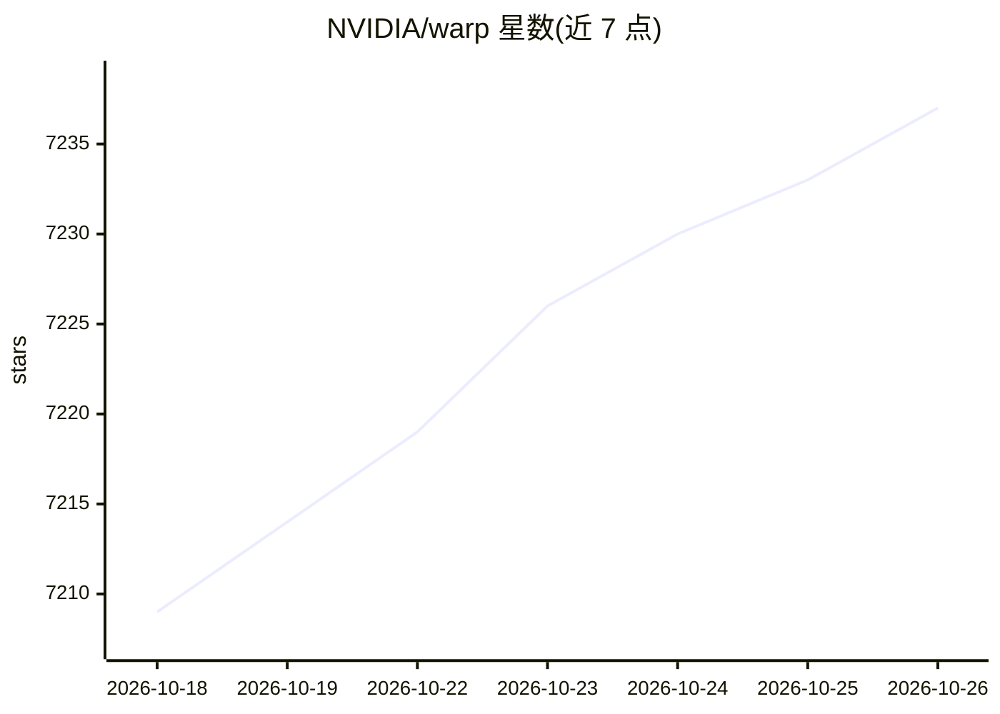

# NVIDIA/warp

⭐ 7,237 · Python · Apache-2.0 · 推送 2026-10-25 · [GitHub](https://github.com/NVIDIA/warp) · [官网](https://nvidia.github.io/warp/stable/) · 组织维护

**GPU 加速仿真/机器人/机器学习 Python 框架，Python 函数 JIT 编译为 CPU/GPU 内核**

NVIDIA 维护的 Python 框架：将常规 Python 函数 JIT 编译为可在 CPU 或 GPU 上运行的高效内核代码，提供物理仿真、机器人、几何处理等原语集，内核可微分并可与 PyTorch、JAX、Paddle 等 ML 框架配合使用。通过 PyPI 发布 warp-lang wheel，覆盖 Windows x86-64、Linux x86-64/AArch64 与 macOS Apple Silicon；CUDA 加速需 NVIDIA R580 以上驱动与 Turing 及以上 GPU（macOS 仅 CPU）。附带大量示例与 Colab 教程笔记本。

## 筛选速览

| 维度 | 判定 | 备注 |
|---|---|---|
| AI 角色 | `ai-ecosystem` | LLM/agent 周边工具 |
| 许可风险 | `permissive` | Apache-2.0 |
| 部署形态 | `library` | 以包/库形式分发 |
| 模型依赖 | — | README 未给出锁定关系 |
| 硬件要求 | — | 无带数字的原话,不猜 |
| 安装摩擦 | `medium` | 含编译或系统依赖之一 |
| 成熟度 | — | 结构信号不足 |

## 能力要点

- Python 函数 JIT 编译为 CPU/GPU 内核
- 内核可微分，可接入 PyTorch/JAX/Paddle 机器学习流水线
- 内置物理仿真、机器人、几何处理、FEM、tile-based GPU 编程示例
- 支持单 GPU 与多 GPU 示例，发布 Windows/Linux/macOS wheel

## 适用场景

- 编写 GPU 加速的物理仿真（粒子、流体、FEM、湍流）
- 在机器人与几何处理任务中做可微分编程
- 将仿真内核嵌入 PyTorch 等机器学习训练流程

## 场景标签

 · 领域:GPU 计算框架/仿真与机器学习

## 证据(README 行号)

> L12: Warp is a Python framework for GPU-accelerated simulation, robotics, and machine learning. Warp takes
> L16: and more. Warp kernels are differentiable and can be used as part of machine-learning pipelines
> L17: with frameworks such as PyTorch, JAX and Paddle.

## 星数曲线

2026-10-18 7,209 → 2026-10-26 7,237（+28）

---
*卡片 v1 · prompt 1.4 · 生成 2026-10-20 · 置信度 high · 依据 README sha `7cc8d3c2f6a3` · [字段定义](../../DATASET.md)*
