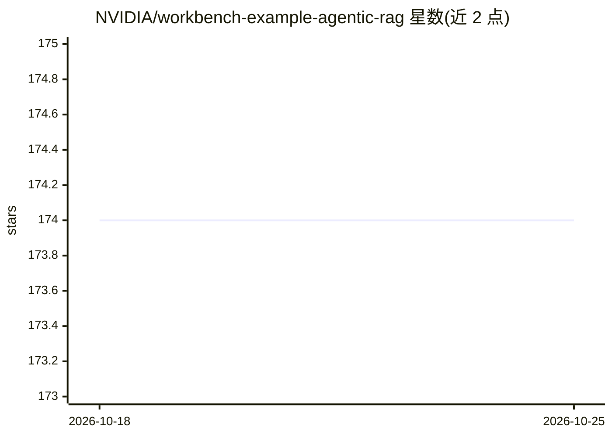

# NVIDIA/workbench-example-agentic-rag

⭐ 174 · Jupyter Notebook · Apache-2.0 · 推送 2026-06-11 · [GitHub](https://github.com/NVIDIA/workbench-example-agentic-rag) · 组织维护

**带准确性与幻觉控制的 Agentic RAG 示例 Web 应用**

NVIDIA AI Workbench 的示例项目：在 RAG 上叠加 agent 层，先判断上下文与查询的相关性，不足时通过 Tavily 加入实时网页搜索；对回答做相关性与准确性评估并标记幻觉，可进行多轮评估-生成循环。用户可编辑提示词、参数与 Gradio 界面代码。推理可使用 build.nvidia.com 免费端点，或自托管 Ollama/NIM（需自带 NVIDIA GPU 与 Docker）。以 Apache 2.0 许可发布。

## 筛选速览

| 维度 | 判定 | 备注 |
|---|---|---|
| AI 角色 | `ai-native` | 本体是模型或模型工具 |
| 许可风险 | `permissive` | Apache-2.0 |
| 部署形态 | `None` |  |
| 模型依赖 | local-ok | 支持本地模型 |
| 硬件要求 | — | 无带数字的原话,不猜 |
| 安装摩擦 | `low` | 无编译、无系统依赖或容器化 |
| 成熟度 | `idea` | |

## 能力要点

- Route/Evaluate/Iterate 三层 agent 循环，含幻觉标记
- 支持免费云端端点（build.nvidia.com）或自托管 Ollama/NIM
- 文档上下文管理：清除、替换 URL、重建向量库
- 可修改提示词、递归限制、Tavily 返回站点数等参数

## 适用场景

- 在 AI Workbench 中快速体验带幻觉控制的 Agentic RAG
- 把自己的文档 URL 加入上下文做问答
- 作为原型代码二次开发：改提示词、换端点、改 Gradio 界面
- 在自有 GPU 上自托管推理端点运行该应用

## 场景标签

`RAG` `文档问答` · 领域:知识与检索

## 证据(README 行号)

> L4: - **Route**: Checks the RAG context for relevance to the query and adds live web search if the context is thin
> L5: - **Evaluate**: Checks responses for relevance and accuracy, flags hallucinations

## 星数曲线

2026-10-18 174 → 2026-10-25 174（+0）

---
*卡片 v1 · prompt 1.4 · 生成 2026-10-22 · 置信度 high · 依据 README sha `035b2542216c` · [字段定义](../../DATASET.md)*
