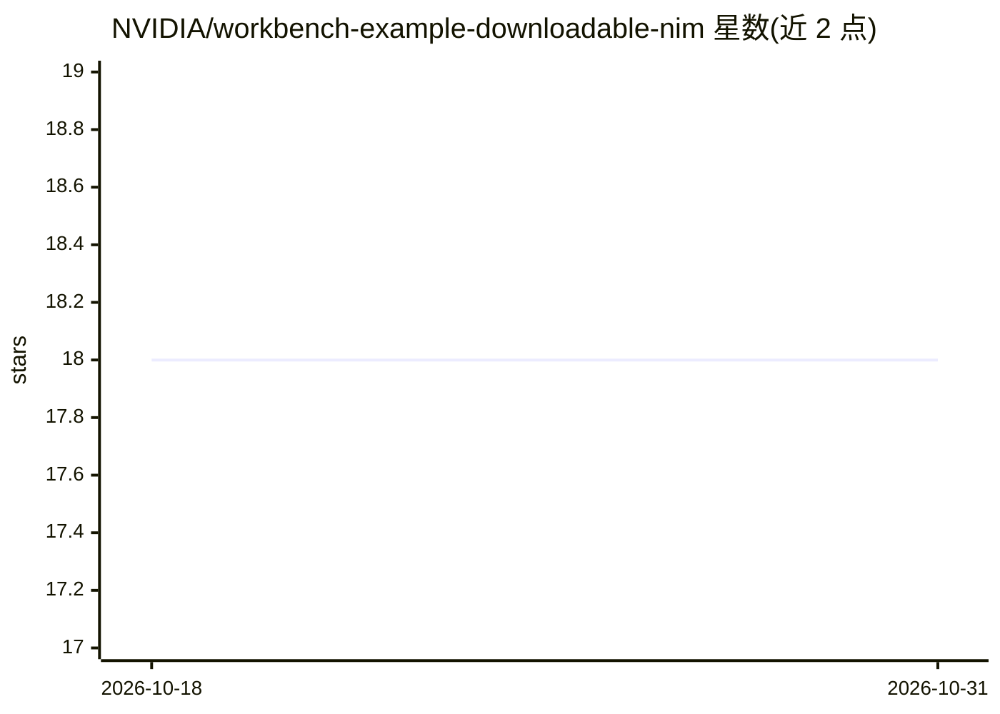

# NVIDIA/workbench-example-downloadable-nim

⭐ 18 · Python · Apache-2.0 · 推送 2026-06-20 · [GitHub](https://github.com/NVIDIA/workbench-example-downloadable-nim) · 组织维护

**在 AI Workbench 中测试 NVIDIA 端点与本地 NIM 的聊天应用示例**

NVIDIA AI Workbench 官方示例项目：一个 Streamlit 聊天应用，可切换使用 build.nvidia.com API 端点（无需 GPU，需配置 NVIDIA_API_KEY）或在本地 NVIDIA GPU 上经 Docker Compose 运行的可下载 NIM 推理容器，复刻 build.nvidia.com 的使用体验。面向在自有环境中搭建与测试 AI 应用的开发者，提供模型选择、GPU 适配提示与 NIM 需求说明；仓库为只读，需 fork 后修改，Apache 2.0 许可。

## 筛选速览

| 维度 | 判定 | 备注 |
|---|---|---|
| AI 角色 | `ai-native` | 本体是模型或模型工具 |
| 许可风险 | `permissive` | Apache-2.0 |
| 部署形态 | `self-host` | docker 或自建部署 |
| 模型依赖 | — | README 未给出锁定关系 |
| 硬件要求 | — | 无带数字的原话,不猜 |
| 安装摩擦 | `low` | 无编译、无系统依赖或容器化 |
| 成熟度 | — | 结构信号不足 |

## 能力要点

- 同一应用内切换 build.nvidia.com 端点与本地自托管 NIM 容器
- Build 端点模式不要求 GPU，仅需 NVIDIA_API_KEY
- 本地 NIM 经 Docker Compose 运行，按 GPU/VRAM/磁盘匹配模型
- Streamlit 纯 Python 应用，可在 JupyterLab/VS Code 中直接修改

## 适用场景

- 在本地 GPU 上测试可下载的 NVIDIA NIM 推理容器
- 对比体验 build.nvidia.com 端点与自托管 NIM 的对话效果
- 作为 AI Workbench 上自定义聊天应用的起点进行二次开发

## 场景标签

`聊天机器人` · 领域:对话与助手

## 证据(README 行号)

> L2: This chat application works interchangeably with build.nvidia.com API endpoints and downloadable NVIDIA NIM containe
> L6: This project is fairly easy to customize because it's a simple Streamlit app that aims to replicate the build.nvidia

## 星数曲线

2026-10-18 18 → 2026-10-31 18（+0）

---
*卡片 v1 · prompt 1.4 · 生成 2026-10-29 · 置信度 mid · 依据 README sha `3c17941212b9` · [字段定义](../../DATASET.md)*
