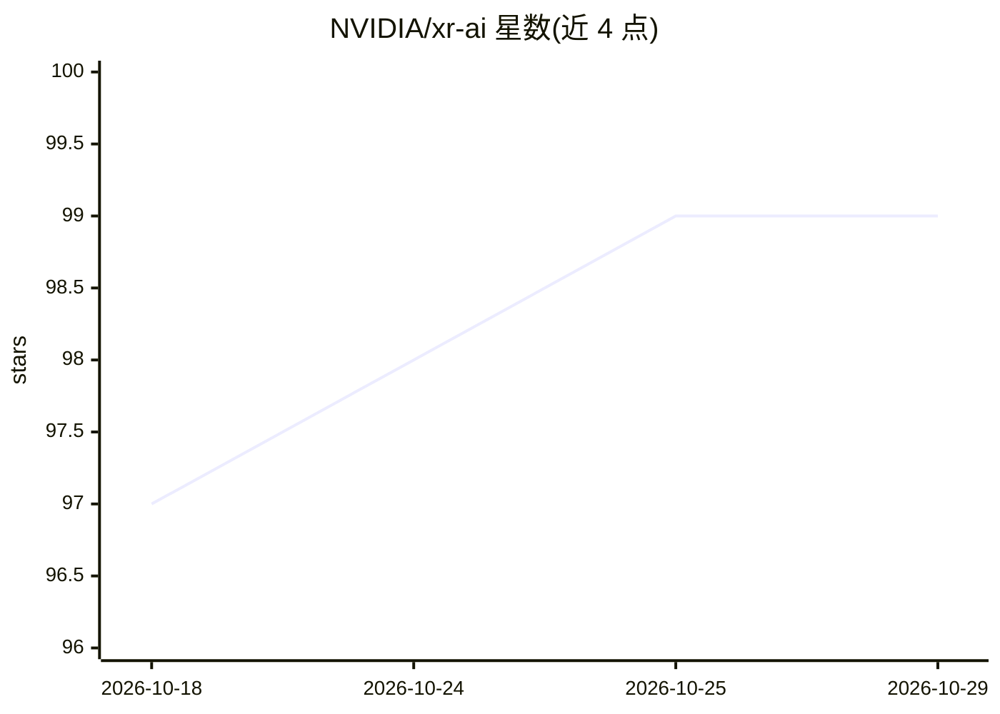

# NVIDIA/xr-ai

⭐ 99 · Python · Apache-2.0 · 推送 2026-10-28 · [GitHub](https://github.com/NVIDIA/xr-ai) · [官网](https://nvidia.github.io/xr-ai/) · 组织维护

**面向 XR 的多模态实时对话 AI agent 开源基础框架**

NVIDIA 维护的 XR AI 框架：将 Web、Android、iOS/visionOS 与原生客户端连接到共享媒体枢纽、GPU 加速的 AI 服务、可调用工具的 agent，以及可选的 CloudXR 远程渲染。agent 可感知参与者所见所闻、调用原生工具并返回音频或数据。提供 agent SDK、6 个示例（语音问答、流程引导、视觉监控等）与版本化文档；需在源码树内基于模板构建自有应用。项目声明为 public beta，API 与行为可能变化。

## 筛选速览

| 维度 | 判定 | 备注 |
|---|---|---|
| AI 角色 | `ai-ecosystem` | LLM/agent 周边工具 |
| 许可风险 | `permissive` | Apache-2.0 |
| 部署形态 | `None` |  |
| 模型依赖 | — | README 未给出锁定关系 |
| 硬件要求 | — | 无带数字的原话,不猜 |
| 安装摩擦 | `low` | 无编译、无系统依赖或容器化 |
| 成熟度 | `idea` | |

## 能力要点

- 跨 Web/Android/iOS/visionOS/原生客户端连接共享媒体枢纽与 GPU 加速 AI 服务
- agent 可感知参与者视听输入、调用原生工具并返回音频或数据
- 从 simple-vlm-example 模板在源码树内构建自有应用
- 6 个可运行 agent 示例与 NIM 端点配置验证

## 适用场景

- 为 XR 客户端构建语音+视觉的多模态对话 agent
- 通过 CloudXR 做语音驱动的远程渲染场景操控
- 基于示例快速搭建流程引导或视觉监控类 agent 应用

## 场景标签

`Agent 框架` `多模态` `语音 Agent` · 领域:Agent 开发

## 证据(README 行号)

> L3: Agentic AI for XR — an open-source foundation for multimodal, real-time
> L6: XR AI connects web, Android, iOS/visionOS, and native clients to a shared media
> L8: rendering. Agents can see and hear what a participant experiences, call native

## 星数曲线

2026-10-18 97 → 2026-10-29 99（+2）

---
*卡片 v1 · prompt 1.4 · 生成 2026-10-23 · 置信度 high · 依据 README sha `a226c5f50f9a` · [字段定义](../../DATASET.md)*
