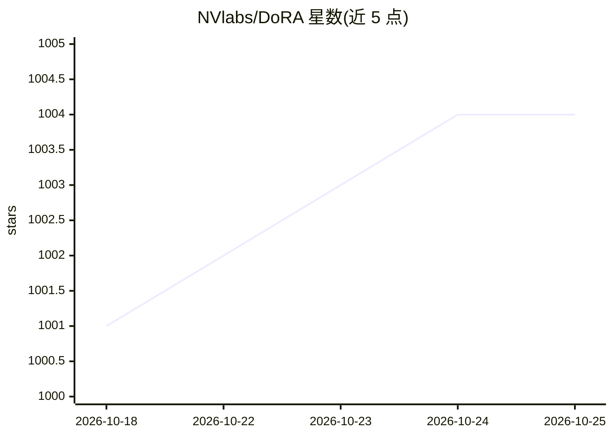

# NVlabs/DoRA

⭐ 1,004 · Python · NOASSERTION · 推送 2026-03-24 · [GitHub](https://github.com/NVlabs/DoRA) · [官网](https://nbasyl.github.io/DoRA-project-page/) · 组织维护

**将预训练权重分解为幅度与方向进行微调的参数高效微调方法官方实现**

NVIDIA 研究团队发布的 DoRA（ICML 2024 Oral）官方 PyTorch 实现：将预训练权重分解为幅度与方向两个分量，用 LoRA 做方向更新以减少可训练参数。仓库包含四个复现目录，覆盖 LLaMA 系列常识推理与指令微调、VL-BART 图像/视频-文本理解、LLaVA-1.5 视觉指令微调，并给出 DoRA 与 LoRA 的基准结果表。日常使用路径是 HuggingFace PEFT 包中设置 use_dora=True；扩散模型上的 DoRA 微调标注为实验性，超参需相对 LoRA 调整。

## 筛选速览

| 维度 | 判定 | 备注 |
|---|---|---|
| AI 角色 | `ai-ecosystem` | LLM/agent 周边工具 |
| 许可风险 | `none` | NOASSERTION |
| 部署形态 | `library` | 以包/库形式分发 |
| 模型依赖 | — | README 未给出锁定关系 |
| 硬件要求 | — | 无带数字的原话,不猜 |
| 安装摩擦 | `low` | 无编译、无系统依赖或容器化 |
| 成熟度 | `idea` | |

## 能力要点

- 权重分解为幅度+方向、以 LoRA 做方向更新的微调机制
- 四个任务复现目录：常识推理/指令微调/图文理解/视觉指令微调
- 已并入 HuggingFace PEFT 包（use_dora 参数），支持 Linear/Conv1d/Conv2d 及 bitsandbytes 量化层
- 提供 DoRA vs LoRA 在 LLaMA/LLaMA2/LLaMA3 上的常识推理结果表

## 适用场景

- 研究者复现 ICML 2024 论文中的微调实验
- 通过 PEFT 包在 LLM 或多模态模型上做参数高效微调
- 对比不同 rank 下 DoRA 与 LoRA 的微调效果

## 场景标签

`微调` · 领域:训练与推理

## 证据(README 行号)

> L3: The Official PyTorch implementation of **DoRA: Weight-Decomposed Low-Rank Adaptation** [ICML2024 (Oral, acceptance r
> L12: DoRA decomposes the pre-trained weight into two components, *magnitude* and *direction*, for fine-tuning, specifica
> L33: DoRA is now supported by the Huggingface PEFT package. You can install the PEFT package using

## 星数曲线

2026-10-18 1,001 → 2026-10-25 1,004（+3）

---
*卡片 v1 · prompt 1.4 · 生成 2026-10-21 · 置信度 mid · 依据 README sha `235f9a0d268c` · [字段定义](../../DATASET.md)*
