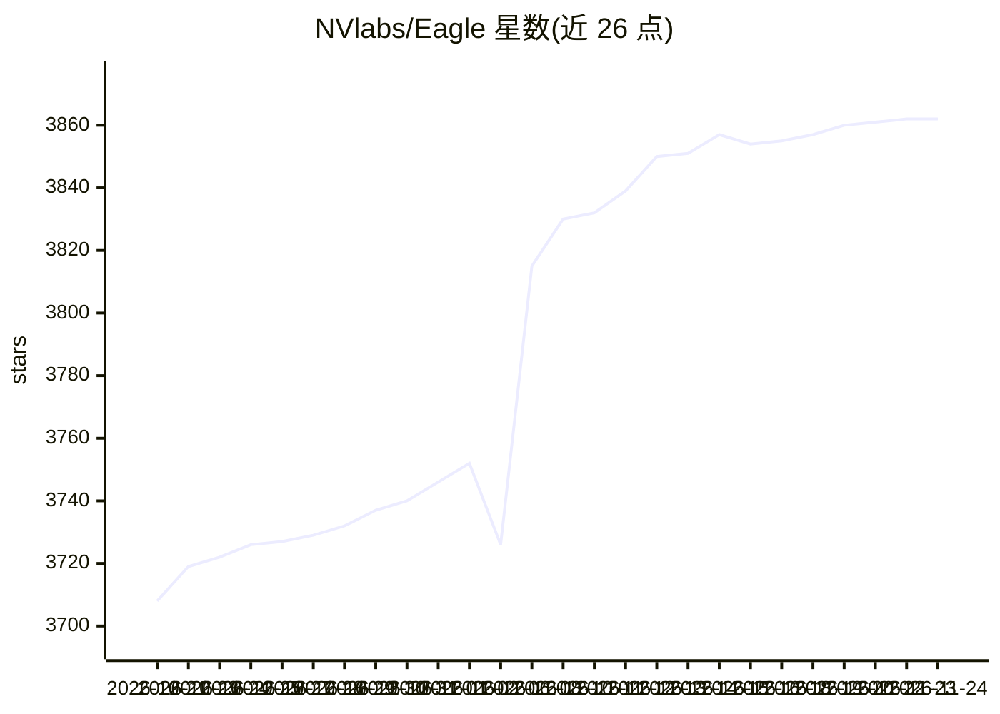

# NVlabs/Eagle

⭐ 3,864 · Python · Apache-2.0 · 推送 2026-11-07 · [GitHub](https://github.com/NVlabs/Eagle) · [官网](https://nvlabs.github.io/Eagle/) · 组织维护

**NVIDIA 视觉-语言模型族：图像/视频理解与视觉定位**

NVIDIA 发布的视觉-语言模型家族，以数据为中心策略覆盖多模态理解、长上下文推理与具身应用。包含五个成员：初代 Eagle（混合编码器）、Eagle 2（图像理解后训练数据策略）、Eagle 2.5（长上下文图像/视频理解）、LocateAnything（通用视觉定位，统一支持文档理解、GUI grounding、密集检测与 OCR，采用 Parallel Box Decoding）与 VFlash（通过 Flash Primitive Decoding 并行生成轨迹、框、点与密集运动的视觉规划框架）。模型以 Hugging Face 集合形式提供，代码含训练与推理脚本。

## 筛选速览

| 维度 | 判定 | 备注 |
|---|---|---|
| AI 角色 | `ai-native` | 本体是模型或模型工具 |
| 许可风险 | `permissive` | Apache-2.0 |
| 部署形态 | `None` |  |
| 模型依赖 | — | README 未给出锁定关系 |
| 硬件要求 | — | 无带数字的原话,不猜 |
| 安装摩擦 | `low` | 无编译、无系统依赖或容器化 |
| 成熟度 | — | 结构信号不足 |

## 能力要点

- LocateAnything 统一执行文档理解、GUI grounding、密集目标检测与 OCR
- Parallel Box Decoding 在单次前向中原子的预测每个边界框
- VFlash 通过 Flash Primitive Decoding 并行生成视觉规划原语
- 提供模型技术报告、Hugging Face 模型集合与演示页面

## 适用场景

- 对图像与长视频进行理解、分段与字幕生成
- 执行文档理解与图形界面元素定位
- 为机器人与驾驶场景生成视觉规划轨迹

## 场景标签

`多模态` `目标检测` `OCR` · 领域:感知与多模态

## 证据(README 行号)

> L40: **Eagle** is a family of frontier vision-language models (VLMs) from NVIDIA that explore data-centric strategies ac
> L47: |**LocateAnything**|Generalist grounding, detection and pointing|Fast & high quality vision-language grounding with

## 星数曲线

2026-10-21 3,708 → 2026-11-24 3,862（+154）

---
*卡片 v1 · prompt 1.4 · 生成 2026-11-23 · 置信度 high · 依据 README sha `1caa21e6643b` · [字段定义](../../DATASET.md)*
