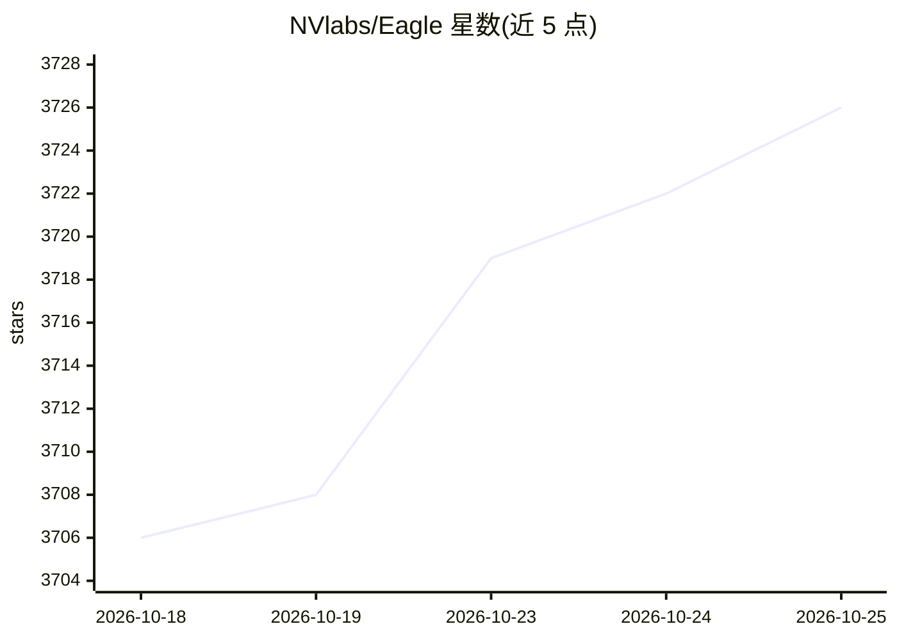

# NVlabs/Eagle

⭐ 3,726 · Python · Apache-2.0 · 推送 2026-06-24 · [GitHub](https://github.com/NVlabs/Eagle) · [官网](https://nvlabs.github.io/Eagle/) · 组织维护

**NVIDIA 前沿视觉-语言模型家族：图像/视频理解与定位**

NVIDIA 发布的视觉-语言模型系列（Eagle、Eagle 2、Eagle 2.5、LocateAnything），探索以数据为中心的训练策略，覆盖多模态理解、长上下文推理与具身应用。LocateAnything 提供统一 VLM 下的接地/检测/指向，采用 Parallel Box Decoding 单次前向预测边界框，并支持纯 FlashAttention 运行时的批推理。Eagle 系列被用作 GR00T-N1/N1.5/N1.6、Nemotron VLM 等 NVIDIA 产品的 VLM 骨干。模型托管于 HuggingFace，代码分 Code License 与 Model License。

## 筛选速览

| 维度 | 判定 | 备注 |
|---|---|---|
| AI 角色 | `ai-native` | 本体是模型或模型工具 |
| 许可风险 | `permissive` | Apache-2.0 |
| 部署形态 | `None` |  |
| 模型依赖 | — | README 未给出锁定关系 |
| 硬件要求 | — | 无带数字的原话,不猜 |
| 安装摩擦 | `low` | 无编译、无系统依赖或容器化 |
| 成熟度 | — | 结构信号不足 |

## 能力要点

- Eagle 家族含通用理解（Eagle 2.5 长上下文图像/视频理解）与接地模型（LocateAnything）
- Parallel Box Decoding 单次前向预测边界框，提升解码吞吐
- LocateAnything 支持 FlashAttention 运行时批推理（A100、RTX 4090 等）与 LoRA 视觉提示微调脚本
- Eagle 原生分辨率变体被采用为 GR00T-N1.6 的 VLM 骨干

## 适用场景

- 需要开源 VLM 做图像/视频理解与长视频推理的研究或开发
- 文档理解、GUI 接地、密集检测与 OCR 等统一定位任务
- 作为具身智能（Physical AI）系统的视觉骨干模型

## 场景标签

`多模态` `目标检测` · 领域:感知与多模态

## 证据(README 行号)

> L38: **Eagle** is a family of frontier vision-language models (VLMs) from NVIDIA that explore data-centric strategies ac
> L40: Beyond advancing multimodal foundation model research, Eagle has also served as a research and development platform
> L44: |**LocateAnything**|Generalist grounding, detection and pointing|Fast & high quality vision-language grounding with

## 星数曲线

2026-10-18 3,706 → 2026-10-25 3,726（+20）

---
*卡片 v1 · prompt 1.4 · 生成 2026-10-20 · 置信度 high · 依据 README sha `d591a49ab0b1` · [字段定义](../../DATASET.md)*
