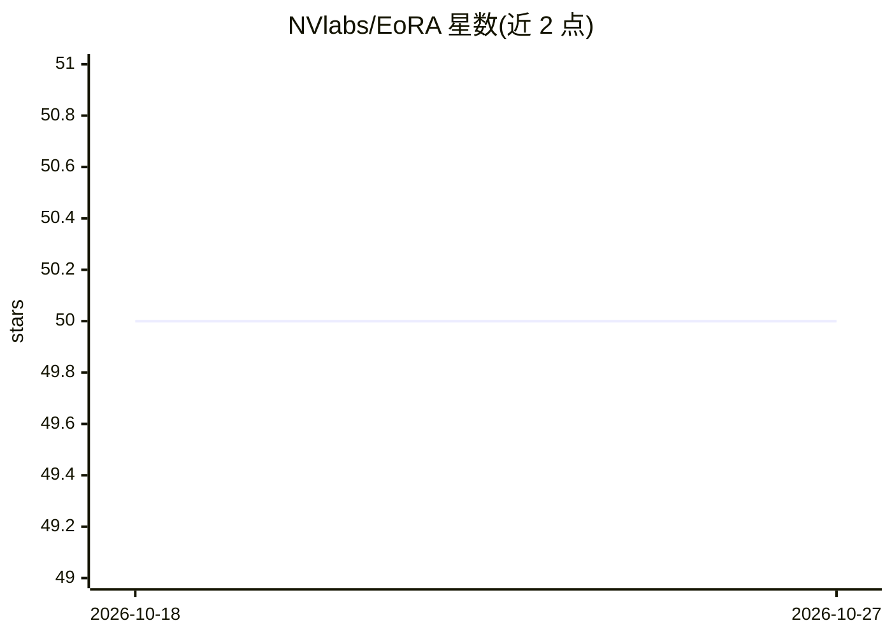

# NVlabs/EoRA

⭐ 50 · Python · NOASSERTION · 推送 2026-04-21 · [GitHub](https://github.com/NVlabs/EoRA) · [官网](https://arxiv.org/abs/2410.21271) · 组织维护

**免微调的压缩 LLM 低秩补偿方法，恢复量化/剪枝模型精度**

NVIDIA Research 出品的研究成果（ICLR 2026 workshop 论文）：对量化/压缩后的 LLM 附加低秩矩阵做特征空间低秩近似补偿，无需微调即可恢复任务精度，支持精度与计算开销的折中调整。报告在 LLaMA3-8B 3-bit 压缩下 ARC-Challenge 提升 10.84%、GSM8K 提升 11.45%。附带优化的 CUDA kernel（推理加速最高 1.4x）并可对补偿矩阵量化以降低显存。代码已集成进 GPTQModel，通过其 Python API 与示例脚本使用，面向科研与模型部署开发者。

## 筛选速览

| 维度 | 判定 | 备注 |
|---|---|---|
| AI 角色 | `ai-ecosystem` | LLM/agent 周边工具 |
| 许可风险 | `none` | NOASSERTION |
| 部署形态 | `None` |  |
| 模型依赖 | — | README 未给出锁定关系 |
| 硬件要求 | — | 无带数字的原话,不猜 |
| 安装摩擦 | `medium` | 含编译或系统依赖之一 |
| 成熟度 | — | 结构信号不足 |

## 能力要点

- 免微调的低秩矩阵补偿，恢复压缩 LLM 精度
- 支持精度与计算开销的折中（可调秩）
- 优化 CUDA kernel，推理加速最高 1.4x
- 已集成进 GPTQModel，提供量化→生成补偿→评测的完整流程

## 适用场景

- 量化部署 LLM 后低成本找回精度损失
- 复现论文中各压缩率下的评测结果
- 在 GPTQModel 流程中生成并评测 EoRA 补偿

## 场景标签

`模型量化` · 领域:训练与推理

## 证据(README 行号)

> L1: [ICLRW'26] EoRA: Fine-tuning-free Compensation for Compressed LLM with Eigenspace Low-Rank Approximation
> L10: EoRA is a novel fine-tuning-free method that augments compressed LLMs with low-rank matrices, allowing users to rap
> L21: # 🔧 **GPTQModel Support**

## 星数曲线

2026-10-18 50 → 2026-10-27 50（+0）

---
*卡片 v1 · prompt 1.4 · 生成 2026-10-24 · 置信度 high · 依据 README sha `05a0d79494b3` · [字段定义](../../DATASET.md)*
