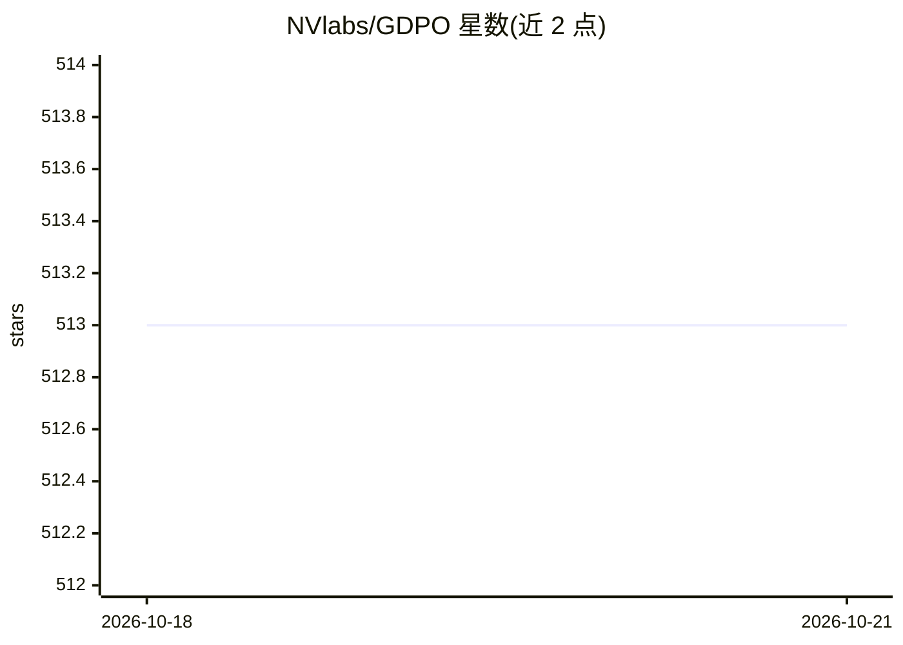

# NVlabs/GDPO

⭐ 513 · Python · Apache-2.0 · 推送 2026-05-20 · [GitHub](https://github.com/NVlabs/GDPO) · 组织维护

**面向研究者的多奖励 RL 训练优化方法（GDPO）官方实现**

NVIDIA 发布的 GDPO 官方实现：一种针对多奖励强化学习训练的优化方法，通过在各单项奖励上解耦归一化，缓解 GRPO 在多奖励设置下的奖励优势坍缩问题。仓库提供基于 VERL、TRL、NeMo-RL 的三套实现，并附带无需 Slurm 的训练脚本，可在单节点 8×A100 约 1 小时或单卡 A100 约 2.5 小时完成一次验证；README 给出工具调用与数学推理任务的完整复现流程（含奖励定义与代码 diff），训练对象为 Qwen2.5-1.5B-Instruct。许可为 NVIDIA Source Code License-NC（非商用）。

## 筛选速览

| 维度 | 判定 | 备注 |
|---|---|---|
| AI 角色 | `ai-ecosystem` | LLM/agent 周边工具 |
| 许可风险 | `permissive` | Apache-2.0 |
| 部署形态 | `None` |  |
| 模型依赖 | — | README 未给出锁定关系 |
| 硬件要求 | — | 无带数字的原话,不猜 |
| 安装摩擦 | `low` | 无编译、无系统依赖或容器化 |
| 成熟度 | — | 结构信号不足 |

## 能力要点

- 按单项奖励解耦归一化的多奖励 RL 训练方法
- 提供 VERL / TRL / NeMo-RL 三套实现
- 无需 Slurm 的训练脚本：8×A100 约 1 小时完成一次运行
- GDPO 作为 GRPO 的 drop-in 替换，README 展示修改前后代码 diff

## 适用场景

- 在工具调用、数学推理等任务上做多奖励 RL 训练
- 对比 GRPO 复现多奖励设置下的训练收敛行为
- 在现有 TRL/verl 训练管线中替换 GRPO 优势估计器

## 场景标签

`强化学习` · 领域:训练与推理

## 证据(README 行号)

> L9: GDPO is a reinforcement learning optimization method designed for multi-reward training. While existing approaches c
> L13: In this repo, we provide implementation of GDPO based on VERL at verl-GDPO, TRL at trl-GDPO, and Nemo-RL at nemo_rl

## 星数曲线

2026-10-18 513 → 2026-10-21 513（+0）

---
*卡片 v1 · prompt 1.4 · 生成 2026-10-22 · 置信度 high · 依据 README sha `091f24c37cc3` · [字段定义](../../DATASET.md)*
