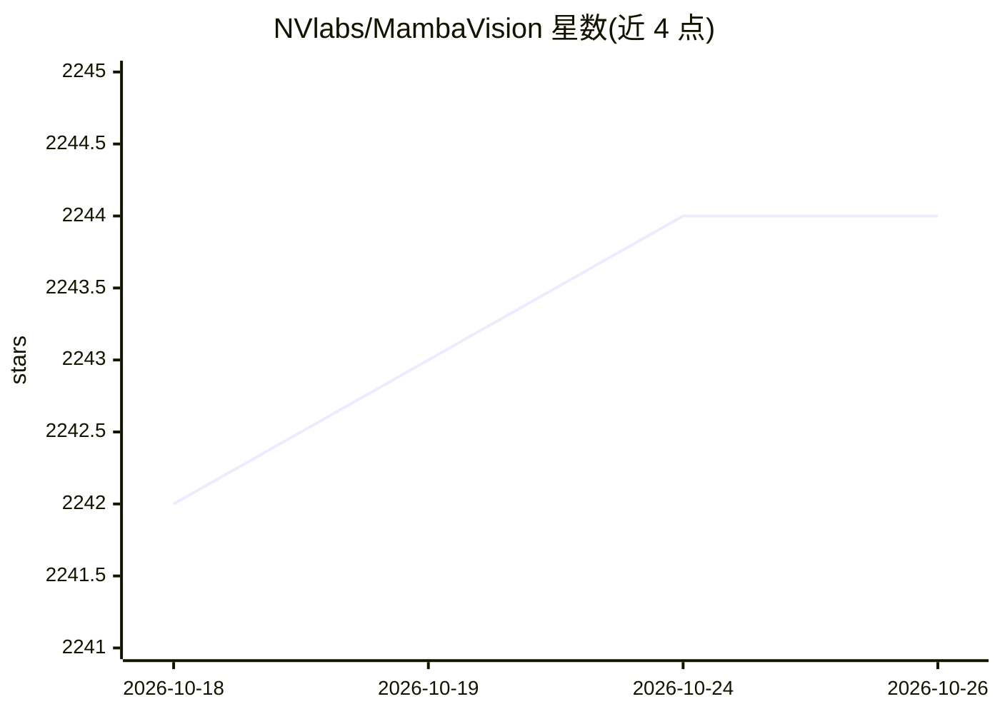

# NVlabs/MambaVision

⭐ 2,244 · Python · NOASSERTION · 推送 2026-03-11 · [GitHub](https://github.com/NVlabs/MambaVision) · [官网](https://arxiv.org/abs/2407.08083) · 组织维护

**混合 Mamba-Transformer 视觉骨干的 PyTorch 官方实现**

NVIDIA 发布的 CVPR 2025 论文官方 PyTorch 实现：提出结合自注意力与 mixer 块的分层架构视觉骨干，含对称无 SSM 路径的 mixer 块设计。提供 ImageNet-1K/21K 预训练模型（最大 739.6M 参数），并发布目标检测（Cascade Mask R-CNN）与语义分割（UPerNet）的代码和模型，支持任意分辨率输入。可通过 pip 包或 Hugging Face transformers 加载，权重以 CC-BY-NC-SA-4.0 发布（非商业），并提供 Docker 文件与 Colab 示例。

## 筛选速览

| 维度 | 判定 | 备注 |
|---|---|---|
| AI 角色 | `ai-native` | 本体是模型或模型工具 |
| 许可风险 | `none` | NOASSERTION |
| 部署形态 | `library` | 以包/库形式分发 |
| 模型依赖 | — | README 未给出锁定关系 |
| 硬件要求 | — | 无带数字的原话,不猜 |
| 安装摩擦 | `medium` | 含编译或系统依赖之一 |
| 成熟度 | — | 结构信号不足 |

## 能力要点

- 混合 Mamba-Transformer 分层架构，含无 SSM 对称路径的 mixer 块
- ImageNet-1K/21K 预训练模型（T 至 L3 变体，最高 Top-1 88.1%）
- 目标检测（Cascade Mask R-CNN）与语义分割（UPerNet）模型及配置
- 支持任意分辨率图像输入与 Hugging Face 加载

## 适用场景

- 我在做图像分类，想用一个混合架构骨干替换现有 backbone
- 把 MambaVision 作为检测/分割任务的骨干网络
- 通过 Hugging Face 或 pip 快速加载预训练模型做特征提取

## 场景标签

`目标检测` · 领域:感知与多模态

## 证据(README 行号)

> L1: # MambaVision: A Hybrid Mamba-Transformer Vision Backbone
> L3: Official PyTorch implementation of **MambaVision: A Hybrid Mamba-Transformer Vision Backbone**.
> L80: >>> model = AutoModelForImageClassification.from_pretrained("nvidia/MambaVision-T-1K", trust_remote_code=True)

## 星数曲线

2026-10-18 2,242 → 2026-10-26 2,244（+2）

---
*卡片 v1 · prompt 1.4 · 生成 2026-10-21 · 置信度 high · 依据 README sha `5e45e3220faf` · [字段定义](../../DATASET.md)*
