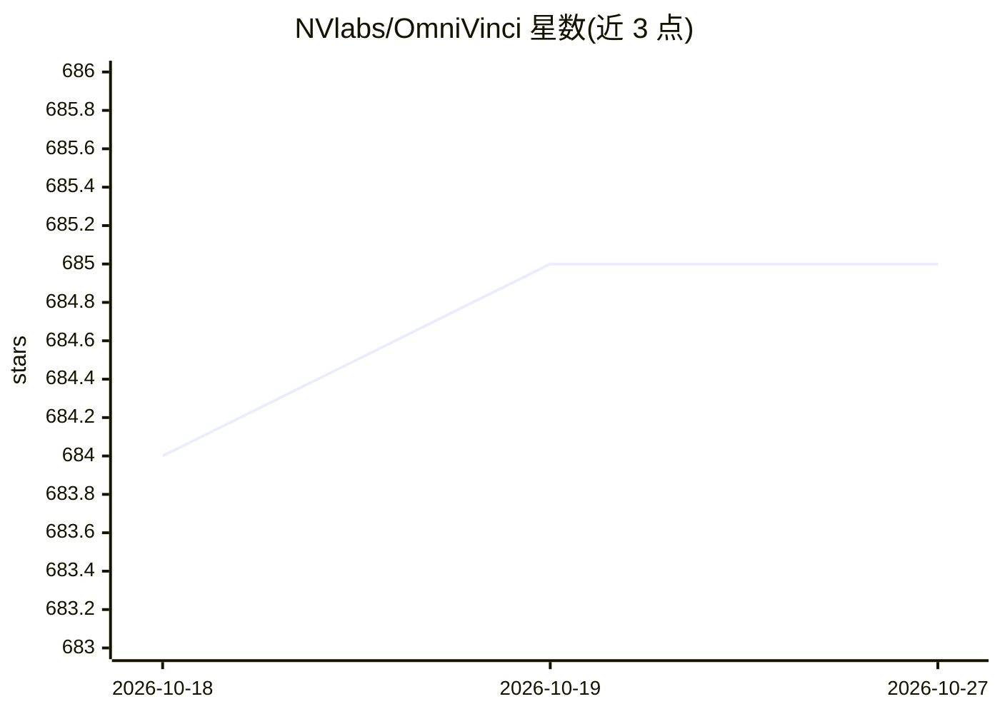

# NVlabs/OmniVinci

⭐ 685 · Python · Apache-2.0 · 推送 2026-08-31 · [GitHub](https://github.com/NVlabs/OmniVinci) · [官网](https://nvlabs.github.io/OmniVinci/) · 组织维护

**NVIDIA 开源全模态 LLM：视觉、音频、语言联合理解**

NVIDIA 研究团队发布的全模态大语言模型（ICLR 2026 投稿，arXiv:2510.15870），支持视觉、音频与文本的联合理解。架构上提出三项设计：OmniAlignNet 视觉-音频对齐、Temporal Embedding Grouping 时序分组、Constrained Rotary Time Embedding 时序编码；数据上通过管线合成 24M 单模态与全模态对话，使用 0.2T 训练 token。基于 NVILA 代码库构建，提供 Hugging Face 权重下载、环境安装脚本与 Transformers 视频音频推理示例。

## 筛选速览

| 维度 | 判定 | 备注 |
|---|---|---|
| AI 角色 | `ai-native` | 本体是模型或模型工具 |
| 许可风险 | `permissive` | Apache-2.0 |
| 部署形态 | `None` |  |
| 模型依赖 | — | README 未给出锁定关系 |
| 硬件要求 | — | 无带数字的原话,不猜 |
| 安装摩擦 | `low` | 无编译、无系统依赖或容器化 |
| 成熟度 | — | 结构信号不足 |

## 能力要点

- 视觉、音频、文本三模态联合理解（OmniVinci-9B）
- OmniAlignNet / Temporal Embedding Grouping / Constrained Rotary Time Embedding 三项架构设计
- 24M 对话的整理与合成数据管线，0.2T 训练 token
- 提供 Transformers 推理示例与基于 NVILA 的环境安装脚本

## 适用场景

- 对视频（含音频）、图像、音频做跨模态理解问答
- 学术研究复现与基准评测（DailyOmni、MMAR、Video-MME 等）
- 机器人、医疗 AI、智能工厂等下游应用的原型验证

## 场景标签

`多模态` · 领域:感知与多模态

## 证据(README 行号)

> L3: # **OmniVinci: Enhancing Architecture and Data for Omni-Modal Understanding LLM (ICLR 2026)**
> L19: We introduce OmniVinci, an initiative to build a strong, open-source, omni-modal LLM.
> L25: We introduce a curation and synthesis pipeline that generates 24M single-modal and omni-modal conversations. We fin

## 星数曲线

2026-10-18 684 → 2026-10-27 685（+1）

---
*卡片 v1 · prompt 1.4 · 生成 2026-10-21 · 置信度 high · 依据 README sha `c45d81957ec5` · [字段定义](../../DATASET.md)*
