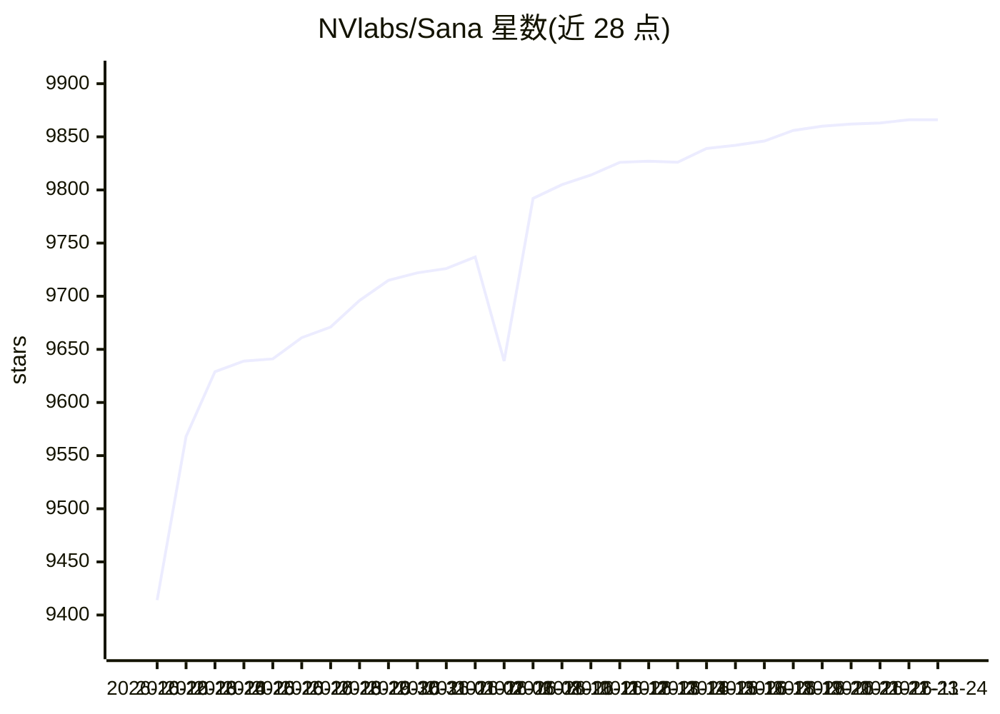

# NVlabs/Sana

⭐ 9,872 · Python · Apache-2.0 · 推送 2026-11-23 · [GitHub](https://github.com/NVlabs/Sana) · [官网](https://nvlabs.github.io/Sana/docs/) · 组织维护

**面向开发者的高效图像视频生成模型训练与推理代码库**

NVIDIA Labs 维护的生成模型代码库，包含 SANA 系列（文生图最高 4K）、SANA-Video（文生视频）、世界模型与机器人模型等子项目，提供完整训练与推理管线、模型权重与文档。机制上采用线性注意力 DiT、蒸馏少步生成（sCM）、量化推理（8bit/4bit）等；通过 diffusers、ComfyUI、SGLang 等生态集成发布。许可证为 Apache 2.0。

## 筛选速览

| 维度 | 判定 | 备注 |
|---|---|---|
| AI 角色 | `ai-native` | 本体是模型或模型工具 |
| 许可风险 | `permissive` | Apache-2.0 |
| 部署形态 | `None` |  |
| 模型依赖 | — | README 未给出锁定关系 |
| 硬件要求 | `gpu-8g` | |
| 安装摩擦 | `low` | 无编译、无系统依赖或容器化 |
| 成熟度 | — | 结构信号不足 |

## 能力要点

- 提供 SANA 系列图像/视频生成模型的训练与推理完整管线
- 支持 8bit/4bit 量化推理，官方文档给出 8GB 显存运行 4K 生成的配置
- 模型已集成进 diffusers、ComfyUI、SGLang，SGLang 提供 OpenAI 兼容 API
- 发布多组开源权重（HuggingFace）及在线 Demo

## 适用场景

- 生成高分辨率图像和视频
- 在消费级 GPU 上部署少步生成模型做快速出图
- 基于开源权重做图像/视频模型的微调或后训练
- 接入 ComfyUI 工作流进行图像生成

## 场景标签

`图像生成` `视频生成` `微调` `模型量化` · 领域:内容生成

## 证据(README 行号)

> L25: **SANA** is an efficiency-oriented codebase for high-resolution image and video generation, providing complete trai
> L98: We introduce **SANA**, a series of efficient diffusion models for high-resolution image and video generation:
> L100: - **SANA**: Text-to-image generation up to 4K resolution, **20× smaller and 100× faster** than Flux-12B.

## 星数曲线

2026-10-22 9,414 → 2026-11-24 9,866（+452）

---
*卡片 v1 · prompt 1.4 · 生成 2026-11-24 · 置信度 high · 依据 README sha `5c3fdc3b53d1` · [字段定义](../../DATASET.md)*
