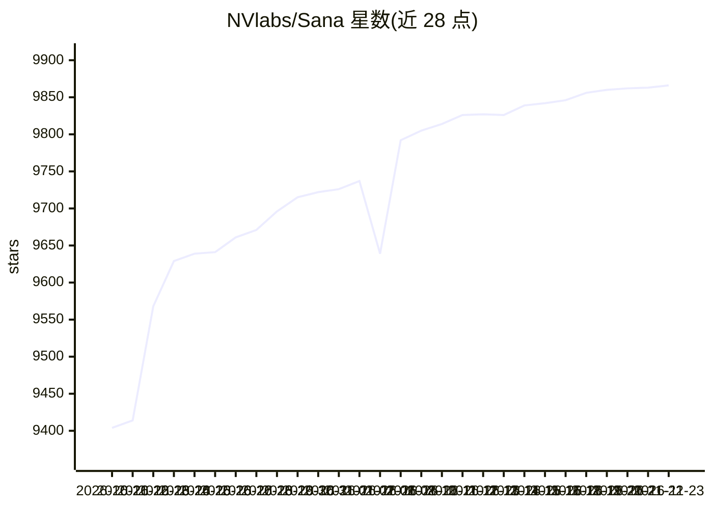

# NVlabs/Sana

⭐ 9,866 · Python · Apache-2.0 · 推送 2026-11-22 · [GitHub](https://github.com/NVlabs/Sana) · [官网](https://nvlabs.github.io/Sana/docs/) · 组织维护

**面向开发者的高分辨率图像/视频生成模型训练推理代码库**

NVIDIA Labs 维护的 SANA 系列高效扩散模型代码库，覆盖 SANA、SANA-1.5、SANA-Sprint、SANA-Video、SANA-WM、SANA-Streaming、Sol-RL 等子项目，提供完整的训练与推理流水线。模型采用线性注意力 DiT 架构，支持文生图（最高 4K）、文生视频与流式编辑；发布权重于 HuggingFace，可经 diffusers、ComfyUI、SGLang（OpenAI 兼容 API）运行；附带 RL 后训练方案与 Cosmos-RL 集成。代码库采用 Apache 2.0 许可。

## 筛选速览

| 维度 | 判定 | 备注 |
|---|---|---|
| AI 角色 | `ai-native` | 本体是模型或模型工具 |
| 许可风险 | `permissive` | Apache-2.0 |
| 部署形态 | `None` |  |
| 模型依赖 | — | README 未给出锁定关系 |
| 硬件要求 | `gpu-8g` | |
| 安装摩擦 | `low` | 无编译、无系统依赖或容器化 |
| 成熟度 | — | 结构信号不足 |

## 能力要点

- 覆盖图像、视频、世界建模的完整训练与推理流水线
- SANA-Sprint 单步蒸馏：H100 上 0.1 秒生成 1024px 图像
- 支持 diffusers、ComfyUI、SGLang 等多种运行方式
- 提供 Sol-RL NVFP4/BF16 强化学习后训练方案与数据集

## 适用场景

- 训练或微调自己的文生图/文生视频模型
- 在本地 GPU 上高效推理生成高分辨率图像与视频
- 通过 ComfyUI 工作流集成 SANA 系列模型
- 用 Cosmos-RL 对 SANA 模型做 SFT/RL 后训练

## 场景标签

`图像生成` `视频生成` `模型训练` `强化学习` · 领域:内容生成

## 证据(README 行号)

> L25: **SANA** is an efficiency-oriented codebase for high-resolution image and video generation, providing complete trai
> L97: We introduce **SANA**, a series of efficient diffusion models for high-resolution image and video generation:
> L99: - **SANA**: Text-to-image generation up to 4K resolution, **20× smaller and 100× faster** than Flux-12B.

## 星数曲线

2026-10-21 9,404 → 2026-11-23 9,866（+462）

---
*卡片 v1 · prompt 1.4 · 生成 2026-11-22 · 置信度 high · 依据 README sha `dc3e5f1a61b4` · [字段定义](../../DATASET.md)*
