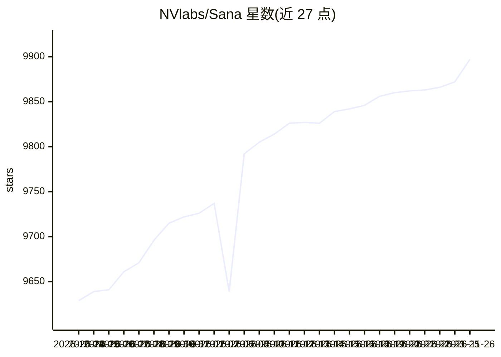

# NVlabs/Sana

⭐ 9,897 · Python · Apache-2.0 · 推送 2026-11-25 · [GitHub](https://github.com/NVlabs/Sana) · [官网](https://nvlabs.github.io/Sana/docs/) · 组织维护

**面向开发者的高效图像/视频生成模型与训练推理代码库**

SANA 是 NVIDIA 实验室发布的效率导向代码库，提供高分辨率图像与视频生成的完整训练和推理流程，包含 SANA、SANA-1.5、SANA-Sprint、SANA-Video、SANA-WM、SANA-Streaming、SANA-Robot、Sol-RL 等多个子项目，覆盖文生图、文生视频、世界模型与机器人动作模型。代码以 Apache 2.0 许可发布，权重托管在 HuggingFace，支持 ComfyUI、SGLang、diffusers、Cosmos-RL 等生态接入，并提供文档与 Discord 社区。

## 筛选速览

| 维度 | 判定 | 备注 |
|---|---|---|
| AI 角色 | `ai-native` | 本体是模型或模型工具 |
| 许可风险 | `permissive` | Apache-2.0 |
| 部署形态 | `None` |  |
| 模型依赖 | — | README 未给出锁定关系 |
| 硬件要求 | `gpu-8g` | |
| 安装摩擦 | `low` | 无编译、无系统依赖或容器化 |
| 成熟度 | — | 结构信号不足 |

## 能力要点

- 包含 SANA 系列图像/视频模型的训练与推理完整流水线
- 权重与演示托管于 HuggingFace，支持 4bit 量化推理（8GB 显存运行 4K 模型）
- SANA-Video 已合并入 diffusers，并提供 ComfyUI 节点与 SGLang 服务支持
- 与 Cosmos-RL 合作提供 SFT/RL 后训练基础设施

## 适用场景

- 生成高分辨率图像和视频
- 对扩散模型做 SFT/RL 后训练
- 在消费级 GPU 上做低显存推理
- 为世界模型和机器人研究提供基线代码

## 场景标签

`图像生成` `视频生成` `模型量化` `强化学习` · 领域:内容生成

## 证据(README 行号)

> L25: **SANA** is an efficiency-oriented codebase for high-resolution image and video generation, providing complete trai
> L98: We introduce **SANA**, a series of efficient diffusion models for high-resolution image and video generation:
> L102: - **SANA-Sprint**: One/few-step generation via sCM distillation, **0.1s per 1024px image** on H100.

## 星数曲线

2026-10-24 9,629 → 2026-11-26 9,897（+268）

---
*卡片 v1 · prompt 1.4 · 生成 2026-11-26 · 置信度 high · 依据 README sha `5e2568da2b9b` · [字段定义](../../DATASET.md)*
