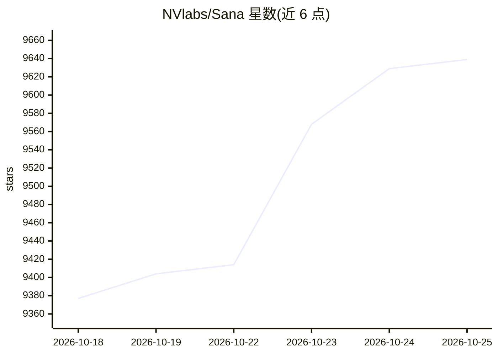

# NVlabs/Sana

⭐ 9,641 · Python · Apache-2.0 · 推送 2026-10-23 · [GitHub](https://github.com/NVlabs/Sana) · [官网](https://nvlabs.github.io/Sana/docs/) · 组织维护

**面向效率的高分辨率图像/视频扩散模型代码库（NVIDIA）**

NVlabs 维护的扩散模型系列代码库，包含 SANA、SANA-1.5、SANA-Sprint、SANA-Video、SANA-WM、SANA-Streaming、Sol-RL 等模型与训练/推理管线。核心机制：用线性注意力替代 DiT 中的 vanilla attention，DC-AE 实现 32× 图像压缩以减少 latent token；SANA-Sprint 通过 sCM 蒸馏实现少步生成，SANA-WM 为 2.6B 可控世界模型（6-DoF 相机控制）。支持 4bit 量化在 8GB VRAM 内运行，代码库许可为 Apache 2.0，多个子工作发表于 ICLR/ICML/ICCV。给需要训练或部署文生图/文生视频模型的开发者和研究者使用。

## 筛选速览

| 维度 | 判定 | 备注 |
|---|---|---|
| AI 角色 | `ai-native` | 本体是模型或模型工具 |
| 许可风险 | `permissive` | Apache-2.0 |
| 部署形态 | `None` |  |
| 模型依赖 | — | README 未给出锁定关系 |
| 硬件要求 | — | 无带数字的原话,不猜 |
| 安装摩擦 | `low` | 无编译、无系统依赖或容器化 |
| 成熟度 | `idea` | |

## 能力要点

- 线性注意力 DiT + DC-AE 32× 压缩的高分辨率生成架构
- 覆盖文本到图像（至 4K）与文本/图到视频的完整训练与推理管线
- 4bit/8bit 量化支持，最低 8GB GPU VRAM 运行
- Sol-RL：NVFP4 rollout、BF16 训练的 RL 后训练方案

## 适用场景

- 训练或微调高效文生图/文生视频扩散模型
- 在消费级 GPU（8GB VRAM）上运行量化生成模型
- 研究世界模型与可控视频生成（6-DoF 相机控制）

## 场景标签

`图像生成` `视频生成` `微调` `模型量化` · 领域:内容生成

## 证据(README 行号)

> L25: **SANA** is an efficiency-oriented codebase for high-resolution image and video generation, providing complete trai
> L94: We introduce **SANA**, a series of efficient diffusion models for high-resolution image and video generation:
> L107: - **Linear Attention**: Replace vanilla attention in DiT with linear attention for efficiency at high resolutions.

## 星数曲线

2026-10-18 9,377 → 2026-10-25 9,639（+262）

---
*卡片 v1 · prompt 1.4 · 生成 2026-10-20 · 置信度 high · 依据 README sha `d2e65c86a5f1` · [字段定义](../../DATASET.md)*
