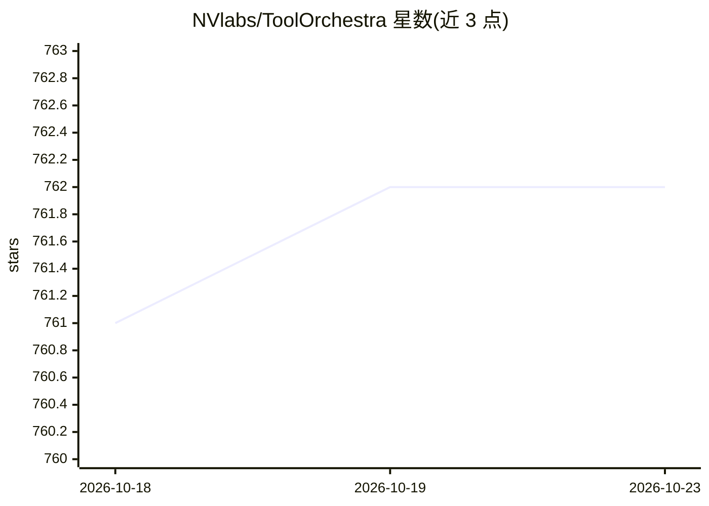

# NVlabs/ToolOrchestra

⭐ 762 · Python · Apache-2.0 · 推送 2026-03-25 · [GitHub](https://github.com/NVlabs/ToolOrchestra) · [官网](https://research.nvidia.com/labs/lpr/ToolOrchestra/) · 组织维护

**训练小模型编排工具与专家模型的端到端 RL 框架**

NVIDIA 与港大联合发布的方法与训练框架：训练 8B 参数的 Orchestrator 模型，使其在多轮推理与工具调用间交替，协调基础工具（搜索、代码解释器）、专家模型与通用 LLM 完成复杂 agentic 任务。训练采用结果、效率与偏好奖励的端到端强化学习，并附带自动合成环境与工具调用任务的数据管线。仓库提供 conda 训练环境、vLLM 推理环境、HLE/FRAMES/τ²-Bench 评测脚本，Apache 2.0 许可，另发布模型检查点与 ToolScale 数据集。

## 筛选速览

| 维度 | 判定 | 备注 |
|---|---|---|
| AI 角色 | `ai-ecosystem` | LLM/agent 周边工具 |
| 许可风险 | `permissive` | Apache-2.0 |
| 部署形态 | `library` | 以包/库形式分发 |
| 模型依赖 | local-ok | 支持本地模型 |
| 硬件要求 | — | 无带数字的原话,不猜 |
| 安装摩擦 | `medium` | 含编译或系统依赖之一 |
| 成熟度 | — | 结构信号不足 |

## 能力要点

- Orchestrator 通过多轮推理+工具调用协调专家模型与通用 LLM
- 端到端 RL 联合优化：结果、效率与偏好奖励
- 自动合成环境与工具调用任务的训练数据管线
- 发布 Orchestrator-8B 检查点与 ToolScale 数据集

## 适用场景

- 训练自己的工具编排/agent 模型
- 复现 HLE、FRAMES、τ²-Bench 上的编排评测
- 构建合成环境与工具调用任务的 RL 训练数据

## 场景标签

`强化学习` `Agent 框架` · 领域:Agent 开发

## 证据(README 行号)

> L24: We introduce **ToolOrchestra**, a method for training small orchestrators that coordinate the use of intelligent to
> L26: With ToolOrchestra, we produce **Orchestrator-8B**, a state-of-the-art 8B parameter orchestration model designed to
> L59: pip install flash-attn --no-build-isolation

## 星数曲线

2026-10-18 761 → 2026-10-23 762（+1）

---
*卡片 v1 · prompt 1.4 · 生成 2026-10-21 · 置信度 high · 依据 README sha `781b41c87b4f` · [字段定义](../../DATASET.md)*
