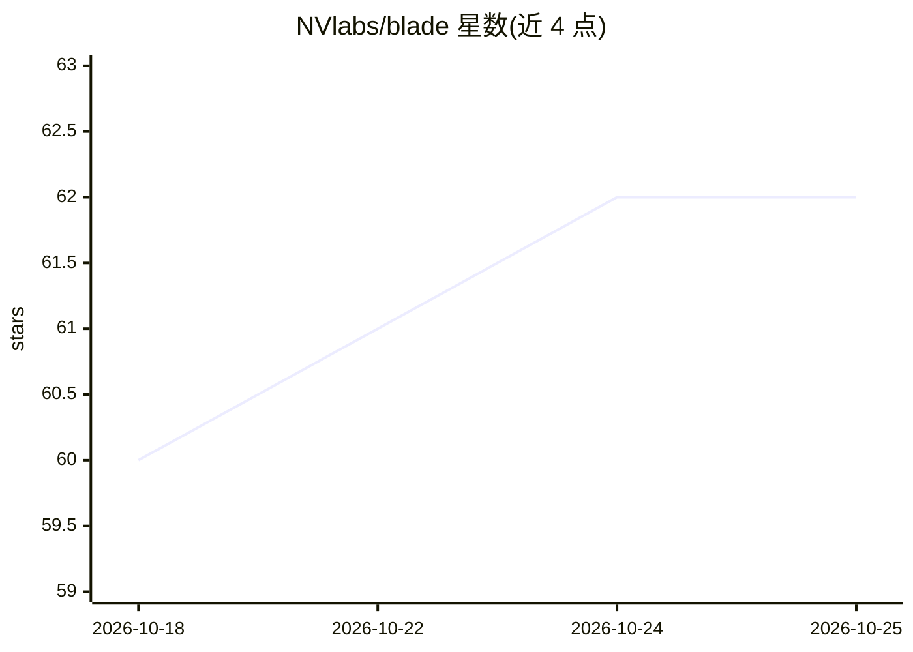

# NVlabs/blade

⭐ 62 · Python · NOASSERTION · 推送 2025-11-04 · [GitHub](https://github.com/NVlabs/blade) · [官网](https://research.nvidia.com/labs/amri/projects/blade/) · 组织维护

**CVPR 2025 论文官方实现：近距人体网格恢复与相机参数求解**

NVIDIA 研究团队发布的 BLADE 官方 PyTorch 实现，处理近距离（透视畸变最强）场景下的单视角人体网格恢复：从图像直接预测骨盆深度 Tz，以 Tz 为条件估计姿态/形状，并通过可微光栅化恢复焦距与完整 3D 平移。面向计算机视觉研究者，提供两阶段训练脚本、评测脚本与推理 API；SMPL/SMPL-X 模型因许可限制需手动下载，训练数据需自行渲染/获取。

## 筛选速览

| 维度 | 判定 | 备注 |
|---|---|---|
| AI 角色 | `ai-native` | 本体是模型或模型工具 |
| 许可风险 | `none` | NOASSERTION |
| 部署形态 | `library` | 以包/库形式分发 |
| 模型依赖 | — | README 未给出锁定关系 |
| 硬件要求 | — | 无带数字的原话,不猜 |
| 安装摩擦 | `medium` | 含编译或系统依赖之一 |
| 成熟度 | — | 结构信号不足 |

## 能力要点

- 直接从图像预测骨盆深度（Tz）并以之为条件估计姿态/形状
- 通过可微光栅化恢复焦距与完整 3D 平移，无启发式假设
- 提供两阶段训练（DepthNet/PoseNet）、多节点训练指南与评测脚本
- 提供推理 API 与 CC0 测试图像的快速 Demo

## 适用场景

- 近距离（如 <1m）场景下的人体网格恢复与相机参数估计
- 复现论文实验或用自有数据训练 BLADE 模型
- 通过 BLADE_API.py 在自己项目中调用人体网格估计

## 场景标签

`图像视频处理` · 领域:感知与多模态

## 证据(README 行号)

> L12: Unlike prior methods that avoid camera recovery and only work well for subjects far from the camera, BLADE tackles 
> L14: 1. **Predicts pelvis depth (Tz)**: directly from the image
> L16: 3. **Recovers full perspective camera**: focal length and XY-translation through differentiable rasterization

## 星数曲线

2026-10-18 60 → 2026-10-25 62（+2）

---
*卡片 v1 · prompt 1.4 · 生成 2026-10-24 · 置信度 mid · 依据 README sha `94e87d827695` · [字段定义](../../DATASET.md)*
